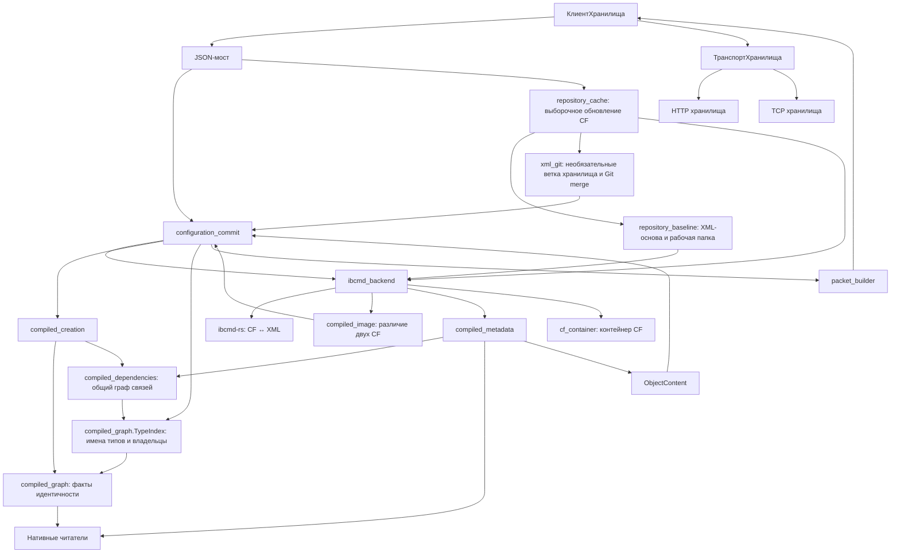

# Карта модулей

Генератор: `python tools/build_module_map.py`; проверка: `--check`.



ibcmd-rs выполняет всё преобразование XML в нативное содержимое. CRS отвечает за протокол хранилища, версии, граф и проверки. Контейнер CF читает и записывает встроенный cf_container; служебный текст формирует native_metadata. Внешних Python-зависимостей и XML-преобразователей проекта больше нет.

## Пример всей цепочки

```text
исходная XML-папка + целевая XML-папка + актуальный CF
  → configuration_export.plan: операции и отпечатки
  → ibcmd_backend: cf export --index → полные изменённые файлы → cf load --base
    при отказе cf load → cf bootstrap --base-free → служебные заголовки исходного CF
    оба пути → обратная выгрузка → проверка полного состава и содержимого файлов
  → compiled_metadata: проверки UUID, типов и привязок → ObjectContent
  → configuration_commit: версии и граф
  → packet_builder.assemble: bytes → Base64 data
  → OneScript ПакетПомещенияОбъекта → ПоместитьПакет → HTTP/TCP
```

Например, изменение Catalogs/Items.xml и Catalogs/Items/Forms/Main/Ext/Form.xml
даёт два ObjectContent и один пакет помещения. Нативные тела и поток формы
получены из CF ibcmd-rs. CRS не преобразует XML-свойства в нативные слоты.

## Контракты

| Функция | Вход | Выход |
| --- | --- | --- |
| `ТранспортХранилища.ПроверитьРазмерСообщения(Знач Размер)` | Размер полного UTF-8 XML-запроса с base64 либо объявленная длина TCP-ответа | Общий предел 256 МиБ; слишком большое сообщение отклоняется до сетевой отправки |
| `preparation_journal.run(request)` | create/save: состояние и кэш; claim: каталог журнала, UUID пользователя, ответ depotInfo и платформа | Ревизия журнала; при восстановлении — сохранённый пакет, квитанция, метки захватов и безопасная фаза; пароль не сохраняется |
| `КлиентХранилища.ВосстановитьПодготовкуПомещения(Знач КаталогПодготовки, Знач ПутьPython = "python")` | Каталог завершённой подготовки и Python; подключённый пользователь того же хранилища | Восстановленная подготовка для отмены собственных захватов или подтверждения исхода; повторное помещение запрещено |
| `КлиентХранилища.ПодготовитьПомещениеКонфигурации(Знач Папка, Знач ИсходнаяПапка = Неопределено, Знач ПутьPython = "python", Знач НастройкиПреобразователя = Неопределено)` | Полная XML-папка, известная основа и настройки кэша/ibcmd/Git | ПодготовкаПомещенияКонфигурации: согласованные пути, пакет и только нужные захваты; например свойство справочника → захват UUID справочника перед компиляцией |
| `ПодготовкаПомещенияКонфигурации.Поместить(Знач Комментарий = "")` | Готовая подготовка и комментарий | Один вызов помещения, обновлённая основа и снятие собственных захватов; прежние захваты остаются |
| `ПодготовкаПомещенияКонфигурации.ПодтвердитьПомещение()` | Неизвестный исход либо не обновлённая основа и сохранённый пакет с квитанцией | Проверенное получение результата без повторного помещения |
| `native_streams.select(metadata, names)` | Метаданные объекта с полем 13 и имена потоков CF | UUID объекта и объявленных внутренних объектов; только принадлежащие им потоки, например feature_uuid.7 → модуль сеанса корня |
| `export_coverage.require_complete_export(image, records, files)` | Образ CF, записи полной XML-выгрузки, словарь путь → байты | Успех либо отказ с именем отсутствующего файла/неизвестного потока; например Form.0 → Form.xml + непустой Module.bsl |
| `configuration_export.plan(request)` | Полная исходная и целевая XML-папки, контекст хранилища | Операции, отпечатки, UUID |
| `configuration_commit.prepare(request)` | Те же папки и контекст | План снимков и изменения |
| `configuration_commit.serialize(request)` | План, снимки, версии, storage, compiler={backend, executable, base_cf} | data, descriptions, requested, externals |
| `ibcmd_backend.Compiler.prepare(self, request, plan, changes, objects)` | Запрос, план, изменения и объекты контекста | Проверенные образы before/after CF |
| `compiled_metadata.content(request, change, objects, before, after)` | Изменение, контекст и образы CF | ObjectContent(docs, body, streams, externals) |
| `packet_builder.assemble(graph, objects)` | Граф и ObjectRecord | Единый двоичный пакет хранилища |
| `repository_cache.Cache.plan(self, request)` | Контекст хранилища и проверенный кэш | UUID изменённых тел, нужные потоки, удаления и поколение |
| `repository_cache.Cache.update(self, request)` | План, контекст, выбранные снимки и подтверждённая версия | Путь base_cf нового поколения и статистика получения |
| `repository_cache.Cache.source(self, request)` | Свежий контекст и UUID нужных снимков | Снимки и полное хранилище исходных данных, собранные локально из кэша |
| `repository_cache.Cache.bootstrap(self, request)` | Полный нативный пакет версии, контекст и неизменившийся UUID версии | Первый CF без seed_cf и проверенное поколение кэша |
| `repository_baseline.initialize(request)` | Проверенный кэш, ibcmd-rs и необязательная рабочая XML-папка | Неизменяемая XML-основа, рабочая папка и манифест; Git не требуется |
| `repository_baseline.read(directory)` | Каталог кэша с baseline.json | Проверенные пути основы и CF; повреждения прекращают чтение |
| `repository_baseline.register(request, changed, payload, removed=())` | Скомпилированный пакет, XML-снимок, изменённые тела и потоки | Квитанция с хешем пакета, ожидаемыми серверными записями и UUID основы |
| `repository_baseline.advance(request)` | Квитанция, пакет и полученное поколение кэша | Новая основа только при полном совпадении серверных данных; рабочие файлы сохраняются |
| `compiled_dependencies.reconcile(request, change, body, image, previous=None, source_body=None, source_image=None)` | Исходный и итоговый CF, полные объявления XML, исходные связи | Нативный список зависимостей: замена доказанных связей, сохранение непрозрачных и структурных |
| `compiled_graph.TypeIndex.reference(self, value)` | Полное имя типа cfg:…, декларации XML и нативные записи CF | UUID типа и UUID владельца либо возможности корня; подтверждение по CF |
| `compiled_graph.read(record, inventory, image, platform='8.5.1.1529')` | Элемент полной XML-выгрузки, карта объектов, нативные записи CF и платформа | Facts: подтверждённые UUID, имя, класс, родитель, возможности, генерируемые типы и хранимые дети |
| `compiled_creation.allocate(request, change, objects, image, root_saved, inventory)` | Новый объект XML, проверенный CF, снимок корня и полная карта объектов | ObjectContent нового объекта с версиями тела и потоков |
| `compiled_creation.finalize(request, change, entry)` | ObjectContent и полный итоговый индекс ссылок | Проверенные UUID типов и зависимости нового объекта |
| `configuration_export.positions(objects)` | Полное дерево метаданных XML | Позиции объектов по классам в коллекциях родителей |
| `native_configuration_reader.stored_collections(documents, object_id, platform)` | Нативный корень CF, UUID корня и платформа | Карта UUID класса → UUID дочерних объектов; проверенные счётчики и уникальность |
| `native_content.compiled_stream_changes(docs, saved, body, oid, before, after, names)` | Снимок, исходные и итоговые потоки CF, имена принадлежащих объекту потоков | ObjectContent: новые версии изменённых потоков, сохранённые версии остальных, удаления без XML-писателя |
| `xml_git.source_reference(branch=DEFAULT_SOURCE_BRANCH)` | Имя source_branch: storage/incoming либо refs/heads/storage/incoming | Проверенный полный ref ветки; неверные и зарезервированные имена отвергаются до записи Git |
| `xml_git.record_source(git, state, files)` | Проверенные XML-файлы полученной версии и состояние кэша | Один коммит серверной версии; повтор использует существующий коммит |
| `xml_git.reconcile(request)` | Кэш, исходная и локальная XML-папки, ibcmd-rs | Коммит версии хранилища, рабочая копия слияния либо отчёт о конфликтах |
| `object_changes.compare(request)` | UUID и полные снимки before/after; отсутствие стороны означает создание/удаление | Изменённые тела/потоки: нативные тексты, diff, Base64, размеры и SHA-256; без сети |
| `object_xml_changes.compare(request)` | UUID, путь ibcmd-rs, платформа, снимки объекта/предков/детей before и after | Представление available: выбранные XML/BSL/двоичные файлы, diff и пути свойств было/стало; unavailable с причиной при неполном экспорте |
| `object_view_context.plan(body, oid, kind, platform)` | Нативное тело, UUID, класс и платформа; например корень со списком языков и UUID основного языка | Именованные коллекции с UUID детей отдельно от структурных UUID-ссылок; нужен снимок основного языка, для прочих детей достаточно исторических имён |
| `object_view_context.bind_children(raw, oid, collection_plan, descriptions)` | XML ibcmd-rs, план коллекций тела и описания детей на момент версии | Полные имена дочерних коллекций в XML при неизменных свойствах и inline-детях; отсутствие имени или противоречие класса/родителя — ошибка |
| `КлиентХранилища.ПоместитьПакет(Знач Пакет, Знач Комментарий = "", Знач ИдентификаторПодключения = Неопределено)` | Любой ПакетПомещенияОбъекта, комментарий и UUID подключения | Единая проверка источников/захватов, один commitObjects, подтверждение описаний и удалений; группа → массив, одиночное изменение/создание → объект, удаление → родитель |

## OneScript

| Модуль | Назначение | Вызывается из | Вызывает |
| --- | --- | --- | --- |
| [ВерсияХранилища](../src/Классы/ВерсияХранилища.os) | Модель версии хранилища. | `КлиентХранилища` | `Вспомогательный` |
| [Вспомогательный](../src/Модули/Вспомогательный.os) | Служебные операции протокола и кодирования. | `ВерсияХранилища`, `КлиентХранилища`, `МенеджерХранилищ`, `ОбработкаXML`, `ПользовательХранилища` | — |
| [ИдентификаторыМетаданных](../src/Модули/ИдентификаторыМетаданных.os) | Доступ OneScript к UUID классов и коллекций. | `КлиентХранилища`, `ПакетПомещенияОбъекта`, `ПравилаПакетовХранилища`, `СериализаторОбъектаХранилища` | — |
| [ИсторияИзменений](../src/Модули/ИсторияИзменений.os) | Классификация создания, изменения и удаления любого класса объектов; сравнение свойств описания до и после. | `КлиентХранилища` | — |
| [КлиентХранилища](../src/Классы/КлиентХранилища.os) | Вызовы через общий HTTP/TCP-транспорт: снимки, захваты, подготовка, помещение и проверки результата. | — | `ВерсияХранилища`, `Вспомогательный`, `ИдентификаторыМетаданных`, `ИсторияИзменений`, `МенеджерЗапросов`, `ОбработкаXML`, `ПодготовкаПомещенияКонфигурации`, `ПользовательХранилища`, `ПравилаПакетовХранилища`, `СериализаторОбъектаХранилища`, `СнимокОбъектаХранилища`, `СовместимостьПлатформы`, `ТранспортХранилища` |
| [МенеджерЗапросов](../src/Модули/МенеджерЗапросов.os) | Формирование XML-запросов протокола хранилища. | `КлиентХранилища`, `МенеджерХранилищ` | `СовместимостьПлатформы` |
| [МенеджерХранилищ](../src/Модули/МенеджерХранилищ.os) | Операции сервера и управление хранилищами. | — | `Вспомогательный`, `МенеджерЗапросов`, `ОбработкаXML`, `ТранспортХранилища` |
| [ОбработкаXML](../src/Модули/ОбработкаXML.os) | Разбор ответов сервера, контекста и описаний объектов. | `КлиентХранилища`, `МенеджерХранилищ` | `Вспомогательный`, `ОбъектХранилища`, `ОтветСервиса`, `СнимокОбъектаХранилища` |
| [ОбъектХранилища](../src/Классы/ОбъектХранилища.os) | Описание объекта и проверки допустимости операций. | `ОбработкаXML`, `ПравилаПакетовХранилища` | — |
| [ОтветСервиса](../src/Классы/ОтветСервиса.os) | Модель ответа сервера и его ошибок. | `ОбработкаXML` | — |
| [ОтветТранспортаХранилища](../src/Классы/ОтветТранспортаХранилища.os) | Код состояния и XML-тело ответа TCP в общем интерфейсе клиента. | `ТранспортХранилища` | — |
| [ПакетПомещенияОбъекта](../src/Классы/ПакетПомещенияОбъекта.os) | Модель пакета, его импорт и проверка состава. | `СериализаторОбъектаХранилища` | `ИдентификаторыМетаданных`, `ПравилаПакетовХранилища`, `СериализаторОбъектаХранилища`, `СовместимостьПлатформы`, `ТранспортХранилища` |
| [ПараметрыСозданияХранилища](../src/Классы/ПараметрыСозданияХранилища.os) | Параметры создания нового хранилища. | — | — |
| [ПодготовкаПомещенияКонфигурации](../src/Классы/ПодготовкаПомещенияКонфигурации.os) | Составная подготовка: владение новыми захватами, сохранение прежних, проверка версий и reviseDate, помещение и подтверждение по квитанции без повторной отправки. | `КлиентХранилища` | `СериализаторОбъектаХранилища` |
| [ПользовательХранилища](../src/Классы/ПользовательХранилища.os) | Описание пользователя хранилища. | `КлиентХранилища` | `Вспомогательный`, `РолиХранилища` |
| [ПравилаПакетовХранилища](../src/Модули/ПравилаПакетовХранилища.os) | Правила операций и состава пакетов по классам объектов. | `КлиентХранилища`, `ПакетПомещенияОбъекта`, `СериализаторОбъектаХранилища` | `ИдентификаторыМетаданных`, `ОбъектХранилища` |
| [РолиХранилища](../src/Модули/РолиХранилища.os) | Роли и права пользователей хранилища. | `ПользовательХранилища` | — |
| [СериализаторОбъектаХранилища](../src/Модули/СериализаторОбъектаХранилища.os) | Подготовка JSON для Python и импорт подготовленных пакетов. | `КлиентХранилища`, `ПакетПомещенияОбъекта`, `ПодготовкаПомещенияКонфигурации` | `ИдентификаторыМетаданных`, `ПакетПомещенияОбъекта`, `ПравилаПакетовХранилища`, `configuration_commit`, `configuration_export`, `external_data`, `metadata_classes`, `object_changes`, `object_xml_changes`, `preparation_journal`, `repository_baseline`, `repository_cache`, `xml_git` |
| [СнимокОбъектаХранилища](../src/Классы/СнимокОбъектаХранилища.os) | Снимок объекта и версия хранилища, на которой он прочитан. | `КлиентХранилища`, `ОбработкаXML` | — |
| [СовместимостьПлатформы](../src/Модули/СовместимостьПлатформы.os) | Проверка поддерживаемого профиля платформы. | `КлиентХранилища`, `МенеджерЗапросов`, `ПакетПомещенияОбъекта` | — |
| [ТранспортХранилища](../src/Модули/ТранспортХранилища.os) | Выбор HTTP или TCP, приветствие сервера, буферизованное чтение, длины сообщений и маркеры конца; без повторной отправки при ошибке. | `КлиентХранилища`, `МенеджерХранилищ`, `ПакетПомещенияОбъекта` | `ОтветТранспортаХранилища` |

## Python

| Модуль | Назначение | Вызывается из | Вызывает |
| --- | --- | --- | --- |
| [cf_container](../src/Сериализация/cf_container.py) | Встроенное чтение и запись контейнеров CF Format15/Format16; адаптированный MIT-код без внешних Python-зависимостей. | `export_coverage`, `ibcmd_backend` | — |
| [compiled_creation](../src/Сериализация/compiled_creation.py) | Метаданные новых владельцев и управляемых форм из проверенного CF: UUID, возможности, потоки, позиция и связи; приложение не сериализуется повторно. | `configuration_commit` | `compiled_dependencies`, `compiled_graph`, `compiled_metadata`, `configuration_export`, `metadata_references`, `metadata_type_references`, `native_content`, `native_form_reader`, `native_metadata`, `native_object_profiles`, `native_object_reader`, `native_references`, `native_streams`, `packet_builder` |
| [compiled_dependencies](../src/Сериализация/compiled_dependencies.py) | Общие связи служебного графа из подтверждённых UUID, объявленных типов и хранимых детей; проверка изменённых ссылок корня и сохранение непрозрачных исходных связей. | `compiled_creation`, `compiled_metadata`, `external_dependencies` | `compiled_graph`, `external_dependencies`, `metadata_type_references`, `native_metadata` |
| [compiled_graph](../src/Сериализация/compiled_graph.py) | Общие факты идентичности: UUID, имя, возможности, генерируемые типы и дочерние коллекции из XML, подтверждённые нативным CF. | `compiled_creation`, `compiled_dependencies`, `configuration_commit`, `metadata_references`, `xml_git` | `configuration_export`, `metadata_identifiers`, `metadata_structure`, `metadata_type_sets`, `native_configuration_reader`, `native_metadata`, `native_object_reader` |
| [compiled_image](../src/Сериализация/compiled_image.py) | Полное различие нативных CF: создание, изменение и удаление тел и потоков с проверкой принадлежности объектам. | `ibcmd_backend` | `native_metadata`, `native_streams` |
| [compiled_metadata](../src/Сериализация/compiled_metadata.py) | Контракты внешнего компилятора: реквизиты владельцев и полные управляемые формы, извлечение итоговых UUID возможностей, согласование типов и зависимостей, проверка привязок. Использует общие нативные читатели; не записывает нативные свойства. | `compiled_creation`, `configuration_commit`, `ibcmd_backend` | `compiled_dependencies`, `configuration_export`, `export_xml`, `metadata_context`, `metadata_references`, `metadata_structure`, `metadata_type_references`, `native_configuration_reader`, `native_content`, `native_features`, `native_form_reader`, `native_metadata`, `native_object_profiles`, `native_object_reader`, `native_streams`, `serialization_context` |
| [configuration_commit](../src/Сериализация/configuration_commit.py) | Компиляция полной выгрузки через ibcmd-rs, удаление хранимых детей, проверки версий и единый пакет помещения. | `СериализаторОбъектаХранилища` | `compiled_creation`, `compiled_graph`, `compiled_metadata`, `configuration_export`, `export_xml`, `external_dependencies`, `ibcmd_backend`, `metadata_context`, `metadata_targets`, `native_metadata`, `native_references`, `packet_builder`, `platform_profiles`, `repository_baseline`, `serialization_context`, `serializer_cli` |
| [configuration_export](../src/Сериализация/configuration_export.py) | Инвентаризация файлов выгрузки и определение операций. | `СериализаторОбъектаХранилища`, `compiled_creation`, `compiled_graph`, `compiled_metadata`, `configuration_commit`, `export_coverage`, `ibcmd_backend`, `metadata_targets`, `repository_baseline`, `xml_git` | `export_xml`, `metadata_context`, `metadata_structure`, `native_metadata`, `native_object_profiles`, `serializer_cli` |
| [export_coverage](../src/Сериализация/export_coverage.py) | Контроль полноты CF → XML по общей карте потоков: модули, составные формы, справка и вложения, картинки, макеты и непрозрачные активы; неизвестные непустые потоки блокируются. | `ibcmd_backend` | `cf_container`, `configuration_export`, `metadata_structure`, `native_metadata`, `native_predefined_reader`, `native_streams` |
| [export_snapshot](../src/Сериализация/export_snapshot.py) | Общая карта версий полной XML-выгрузки и безопасная запись файлов снимка. | `repository_baseline`, `xml_git` | — |
| [export_xml](../src/Сериализация/export_xml.py) | Чтение и проверка XML: export_xml. | `compiled_metadata`, `configuration_commit`, `configuration_export`, `ibcmd_backend` | `metadata_context` |
| [external_data](../src/Сериализация/external_data.py) | Чтение тел объектов и внешних потоков из пакета версии. | `СериализаторОбъектаХранилища`, `external_dependencies`, `ibcmd_backend`, `native_references`, `object_changes`, `object_xml_changes`, `repository_cache` | `native_metadata`, `serializer_cli` |
| [external_dependencies](../src/Сериализация/external_dependencies.py) | Проверка внешних ссылок при удалении; UUID генерируемых типов объектов и вложенных возможностей берутся из подтверждённого индекса исходного CF, без профилей классов. | `compiled_dependencies`, `configuration_commit` | `compiled_dependencies`, `external_data`, `metadata_identifiers`, `native_form_reader`, `native_metadata`, `native_object_profiles`, `native_object_reader`, `native_streams`, `role_rights_native`, `schema_content`, `serialization_context` |
| [form_attribute_types](../src/Сериализация/form_attribute_types.py) | Типы реквизитов формы, включая составные и коллекционные. | `metadata_references` | `metadata_context`, `metadata_identifiers`, `metadata_type_references`, `metadata_type_sets`, `native_metadata` |
| [ibcmd_backend](../src/Сериализация/ibcmd_backend.py) | Внешний компилятор CF ↔ XML: cf load, при отказе полная cf bootstrap --base-free; привязка служебных заголовков, замкнутая проверка всех файлов и результата, общий контроль полноты нативных активов через export_coverage. | `configuration_commit`, `repository_baseline`, `repository_cache`, `xml_git` | `cf_container`, `compiled_image`, `compiled_metadata`, `configuration_export`, `export_coverage`, `export_xml`, `external_data`, `native_metadata`, `native_references`, `serialization_context`, `xml_compare` |
| [metadata_classes](../src/Сериализация/metadata_classes.py) | Получение справочника классов метаданных через Python-вход. | `СериализаторОбъектаХранилища` | `metadata_identifiers`, `native_metadata`, `serializer_cli` |
| [metadata_context](../src/Сериализация/metadata_context.py) | Чтение updateInfo, проверка UUID и карты отдельно хранимых детей. | `compiled_metadata`, `configuration_commit`, `configuration_export`, `export_xml`, `form_attribute_types`, `metadata_references`, `metadata_targets`, `metadata_type_references`, `native_references`, `repository_cache`, `serialization_context` | `native_metadata` |
| [metadata_identifiers](../src/Сериализация/metadata_identifiers.py) | UUID классов, коллекций, типов значений и служебных возможностей; XML-имена классов сопоставляются со служебными именами по карте схемы. | `compiled_graph`, `external_dependencies`, `form_attribute_types`, `metadata_classes`, `metadata_references`, `metadata_targets`, `metadata_type_references`, `metadata_type_sets`, `native_configuration_reader`, `native_predefined_reader`, `native_references`, `object_view_context`, `object_xml_changes` | `metadata_structure` |
| [metadata_references](../src/Сериализация/metadata_references.py) | Значения DesignTimeRef: перечисления, EmptyRef и предопределённые элементы; проверка владельцев и зависимостей форм. | `compiled_creation`, `compiled_metadata` | `compiled_graph`, `form_attribute_types`, `metadata_context`, `metadata_identifiers`, `metadata_targets`, `metadata_type_references`, `metadata_type_sets`, `native_form_reader`, `native_metadata`, `native_object_profiles`, `native_predefined_reader`, `native_references`, `serializer_cli`, `xml_namespace_bindings`, `xml_qnames` |
| [metadata_structure](../src/Сериализация/metadata_structure.py) | Карта классов, дочерних коллекций и их правил хранения. | `compiled_graph`, `compiled_metadata`, `configuration_export`, `export_coverage`, `metadata_identifiers`, `metadata_targets`, `native_configuration_reader`, `native_object_profiles`, `native_object_reader`, `native_references`, `native_streams`, `object_view_context` | — |
| [metadata_targets](../src/Сериализация/metadata_targets.py) | Индекс текущих и итоговых объектов для разрешения ссылок. | `configuration_commit`, `metadata_references`, `native_references` | `configuration_export`, `metadata_context`, `metadata_identifiers`, `metadata_structure`, `native_form_profiles`, `native_metadata` |
| [metadata_type_references](../src/Сериализация/metadata_type_references.py) | Ссылочные типы свойств Type: сопоставление XML-имён с UUID типов итоговой конфигурации. | `compiled_creation`, `compiled_dependencies`, `compiled_metadata`, `form_attribute_types`, `metadata_references` | `metadata_context`, `metadata_identifiers`, `metadata_type_sets`, `native_metadata`, `native_object_profiles`, `native_object_reader`, `native_references`, `serialization_context`, `xml_type_text` |
| [metadata_type_sets](../src/Сериализация/metadata_type_sets.py) | Проверенные групповые типы платформы: XML TypeSet, постоянные UUID и запрет их подмены. | `compiled_graph`, `form_attribute_types`, `metadata_references`, `metadata_type_references` | `metadata_identifiers`, `native_configuration_reader`, `native_metadata` |
| [native_commands](../src/Сериализация/native_commands.py) | Чтение и проверка нативных данных: native_commands. | `native_features` | `native_inline`, `native_metadata`, `native_object_profiles`, `packet_builder` |
| [native_configuration_reader](../src/Сериализация/native_configuration_reader.py) | Чтение свойств и UUID возможностей корня; проверка хранимых дочерних коллекций по UUID классов из схемы без записи нативных свойств. | `compiled_graph`, `compiled_metadata`, `metadata_type_sets`, `object_view_context` | `metadata_identifiers`, `metadata_structure`, `native_metadata`, `platform_profiles` |
| [native_content](../src/Сериализация/native_content.py) | Общий результат преобразования: метаданные, тело, потоки и их версии; без упаковки пакета. | `compiled_creation`, `compiled_metadata` | `native_metadata`, `native_streams`, `packet_builder`, `serialization_context` |
| [native_features](../src/Сериализация/native_features.py) | Чтение и проверка нативных данных: native_features. | `compiled_metadata` | `native_commands`, `native_inline`, `native_metadata`, `native_tabular` |
| [native_form_bindings](../src/Сериализация/native_form_bindings.py) | Чтение и проверка нативных данных: native_form_bindings. | `native_form_reader` | `native_form_profiles`, `native_form_reader`, `native_metadata`, `native_object_profiles` |
| [native_form_profiles](../src/Сериализация/native_form_profiles.py) | Чтение и проверка нативных данных: native_form_profiles. | `metadata_targets`, `native_form_bindings`, `native_object_profiles` | `native_metadata` |
| [native_form_reader](../src/Сериализация/native_form_reader.py) | Чтение и проверка нативных данных: native_form_reader. | `compiled_creation`, `compiled_metadata`, `external_dependencies`, `metadata_references`, `native_form_bindings` | `native_form_bindings`, `native_metadata`, `native_tabular` |
| [native_form_roles](../src/Сериализация/native_form_roles.py) | Чтение и проверка нативных данных: native_form_roles. | `native_object_profiles` | — |
| [native_inline](../src/Сериализация/native_inline.py) | Чтение и проверка нативных данных: native_inline. | `native_commands`, `native_features` | `native_metadata` |
| [native_metadata](../src/Сериализация/native_metadata.py) | Нативное дерево, текст, двоичные записи, сжатие и контейнер хранилища. | `compiled_creation`, `compiled_dependencies`, `compiled_graph`, `compiled_image`, `compiled_metadata`, `configuration_commit`, `configuration_export`, `export_coverage`, `external_data`, `external_dependencies`, `form_attribute_types`, `ibcmd_backend`, `metadata_classes`, `metadata_context`, `metadata_references`, `metadata_targets`, `metadata_type_references`, `metadata_type_sets`, `native_commands`, `native_configuration_reader`, `native_content`, `native_features`, `native_form_bindings`, `native_form_profiles`, `native_form_reader`, `native_inline`, `native_object_reader`, `native_predefined_reader`, `native_references`, `native_streams`, `native_tabular`, `object_changes`, `object_view_context`, `object_xml_changes`, `packet_builder`, `repository_baseline`, `repository_cache`, `role_rights_native`, `serialization_context` | — |
| [native_object_profiles](../src/Сериализация/native_object_profiles.py) | Чтение и проверка нативных данных: native_object_profiles. | `compiled_creation`, `compiled_metadata`, `configuration_export`, `external_dependencies`, `metadata_references`, `metadata_type_references`, `native_commands`, `native_form_bindings`, `native_references`, `native_tabular` | `metadata_structure`, `native_form_profiles`, `native_form_roles`, `platform_profiles` |
| [native_object_reader](../src/Сериализация/native_object_reader.py) | Чтение и проверка нативных данных: native_object_reader. | `compiled_creation`, `compiled_graph`, `compiled_metadata`, `external_dependencies`, `metadata_type_references`, `native_references`, `object_view_context` | `metadata_structure`, `native_metadata` |
| [native_predefined_reader](../src/Сериализация/native_predefined_reader.py) | Чтение имён и UUID предопределённых элементов из нативных потоков справочников и планов; схемы колонок, вложенность и проверка дубликатов, без записи свойств. | `export_coverage`, `metadata_references` | `metadata_identifiers`, `native_metadata` |
| [native_references](../src/Сериализация/native_references.py) | Итоговые ссылки на типы и значения: подготовленные нативные определения либо проверенные исходные снимки/пакет версии. | `compiled_creation`, `configuration_commit`, `ibcmd_backend`, `metadata_references`, `metadata_type_references` | `external_data`, `metadata_context`, `metadata_identifiers`, `metadata_structure`, `metadata_targets`, `native_metadata`, `native_object_profiles`, `native_object_reader`, `serialization_context` |
| [native_streams](../src/Сериализация/native_streams.py) | Принадлежность потоков объектам и объявленным внутренним UUID; общая классификация CF: интерфейс и модуль формы, справка, права, содержимое макета, модули и непрозрачные дополнения; без преобразования содержимого. | `compiled_creation`, `compiled_image`, `compiled_metadata`, `export_coverage`, `external_dependencies`, `native_content`, `repository_cache` | `metadata_structure`, `native_metadata` |
| [native_tabular](../src/Сериализация/native_tabular.py) | Чтение и проверка нативных данных: native_tabular. | `native_features`, `native_form_reader` | `native_metadata`, `native_object_profiles` |
| [object_changes](../src/Сериализация/object_changes.py) | Сравнение полных снимков одного UUID: тела и все потоки, нативный текстовый diff и сохранение непрозрачных двоичных данных без XML-компилятора. | `СериализаторОбъектаХранилища`, `object_xml_changes` | `external_data`, `native_metadata`, `serialization_context`, `serializer_cli` |
| [object_view_context](../src/Сериализация/object_view_context.py) | Чтение коллекций и UUID-ссылок для адресного контекста просмотра; разрешение имён детей из исторических описаний в XML ibcmd-rs, без записи нативных свойств. | `object_xml_changes` | `metadata_identifiers`, `metadata_structure`, `native_configuration_reader`, `native_metadata`, `native_object_reader`, `xml_namespaces` |
| [object_xml_changes](../src/Сериализация/object_xml_changes.py) | Читаемое сравнение выбранного объекта через ibcmd-rs objects export: отдельные нативные строки корня, предков и объекта; XML-свойства, формы и BSL, без полного CF и собственного декодера. | `СериализаторОбъектаХранилища` | `external_data`, `metadata_identifiers`, `native_metadata`, `object_changes`, `object_view_context`, `repository_cache`, `serializer_cli` |
| [packet_builder](../src/Сериализация/packet_builder.py) | Граф помещения, версии, записи объектов и итоговый XML-запрос. | `compiled_creation`, `configuration_commit`, `native_commands`, `native_content`, `repository_cache` | `native_metadata` |
| [platform_profiles](../src/Сериализация/platform_profiles.py) | Выбор профиля платформы и структуры выгрузки. | `configuration_commit`, `native_configuration_reader`, `native_object_profiles`, `repository_cache` | — |
| [preparation_journal](../src/Сериализация/preparation_journal.py) | Журнал составной подготовки: атомарное состояние, владение процессом, блокировка записи, неизменяемый пакет и явное восстановление без повторной отправки. | `СериализаторОбъектаХранилища` | `repository_cache`, `serializer_cli` |
| [repository_baseline](../src/Сериализация/repository_baseline.py) | Инициализация XML-основы и рабочей папки без обязательного Git; квитанции пакетов и атомарное продвижение основы после проверки серверного состояния. | `СериализаторОбъектаХранилища`, `configuration_commit` | `configuration_export`, `export_snapshot`, `ibcmd_backend`, `native_metadata`, `repository_cache`, `serializer_cli`, `xml_git` |
| [repository_cache](../src/Сериализация/repository_cache.py) | Инкрементальный кэш CF: версии объектов и потоков, выборочное получение, удаления, контроль целостности и атомарная смена поколения. | `СериализаторОбъектаХранилища`, `object_xml_changes`, `preparation_journal`, `repository_baseline`, `xml_git` | `external_data`, `ibcmd_backend`, `metadata_context`, `native_metadata`, `native_streams`, `packet_builder`, `platform_profiles`, `serialization_context`, `serializer_cli` |
| [role_rights_native](../src/Сериализация/role_rights_native.py) | Чтение нативных прав и ссылок для проверки зависимостей. | `external_dependencies` | `native_metadata` |
| [schema_content](../src/Сериализация/schema_content.py) | Чтение нативного контейнера СКД для проверки зависимостей. | `external_dependencies` | — |
| [serialization_context](../src/Сериализация/serialization_context.py) | Сопоставление снимка с updateInfo и проверка исходной версии. | `compiled_metadata`, `configuration_commit`, `external_dependencies`, `ibcmd_backend`, `metadata_type_references`, `native_content`, `native_references`, `object_changes`, `repository_cache` | `metadata_context`, `native_metadata` |
| [serializer_cli](../src/Сериализация/serializer_cli.py) | Общий JSON-вход Python, ограничения и запись результата. | `configuration_commit`, `configuration_export`, `external_data`, `metadata_classes`, `metadata_references`, `object_changes`, `object_xml_changes`, `preparation_journal`, `repository_baseline`, `repository_cache`, `xml_git` | — |
| [xml_compare](../src/Сериализация/xml_compare.py) | Чтение и проверка XML: xml_compare. | `ibcmd_backend` | — |
| [xml_git](../src/Сериализация/xml_git.py) | XML-проект Git: коммит каждой полученной версии хранилища в настраиваемой source_branch, трёхстороннее слияние и отдельные рабочие копии без изменения входных папок. | `СериализаторОбъектаХранилища`, `repository_baseline` | `compiled_graph`, `configuration_export`, `export_snapshot`, `ibcmd_backend`, `repository_cache`, `serializer_cli` |
| [xml_namespace_bindings](../src/Сериализация/xml_namespace_bindings.py) | Чтение и проверка XML: xml_namespace_bindings. | `metadata_references` | `xml_namespaces` |
| [xml_namespaces](../src/Сериализация/xml_namespaces.py) | Пространства имён XML и сохранение префиксов QName. | `object_view_context`, `xml_namespace_bindings` | — |
| [xml_qnames](../src/Сериализация/xml_qnames.py) | Чтение и проверка XML: xml_qnames. | `metadata_references` | — |
| [xml_type_text](../src/Сериализация/xml_type_text.py) | Чтение и проверка XML: xml_type_text. | `metadata_type_references` | — |

## Коллекции дерева конфигурации

Схема содержит 95 маршрутов отдельно хранимых детей, достижимых от Configuration. Это карта структуры, а не перечень сквозных проверок ibcmd-rs. Внешние обработки и отчёты в это дерево не входят.

| Родитель | Коллекции отдельно хранимых детей |
| --- | --- |
| `AccountingRegister` | `Form`, `Template` |
| `AccumulationRegister` | `Form`, `Template` |
| `BusinessProcess` | `Form`, `Template` |
| `CalculationRegister` | `Form`, `Recalculation` (UUID из CF), `Template` |
| `Catalog` | `Form`, `Template` |
| `ChartOfAccounts` | `Form`, `Template` |
| `ChartOfCalculationTypes` | `Form`, `Template` |
| `ChartOfCharacteristicTypes` | `Form`, `Template` |
| `Configuration` | `AccountingRegister`, `AccumulationRegister`, `Bot`, `BusinessProcess`, `CalculationRegister`, `Catalog`, `ChartOfAccounts`, `ChartOfCalculationTypes`, `ChartOfCharacteristicTypes`, `CommandGroup`, `CommonAttribute`, `CommonCommand`, `CommonForm`, `CommonModule`, `CommonPicture`, `CommonTemplate`, `Constant`, `DataProcessor`, `DefinedType`, `Document`, `DocumentJournal`, `DocumentNumerator`, `Enum`, `EventSubscription`, `ExchangePlan`, `ExternalDataSource`, `FilterCriterion`, `FunctionalOption`, `FunctionalOptionsParameter`, `HTTPService`, `InformationRegister`, `IntegrationService`, `Interface`, `Language`, `PaletteColor` (UUID из CF), `Report`, `Role`, `ScheduledJob`, `Sequence`, `SessionParameter`, `SettingsStorage`, `Style`, `StyleItem`, `Subsystem`, `Task`, `WSReference`, `WebService`, `WebSocketClient`, `XDTOPackage` |
| `Cube` | `DimensionTable`, `Form`, `Template` |
| `DataProcessor` | `Form`, `Template` |
| `DimensionTable` | `Form`, `Template` |
| `Document` | `Form`, `Template` |
| `DocumentJournal` | `Form`, `Template` |
| `Enum` | `Form`, `Template` |
| `ExchangePlan` | `Form`, `Template` |
| `ExternalDataSource` | `Cube`, `Table` |
| `FilterCriterion` | `Form` |
| `InformationRegister` | `Form`, `Template` |
| `Report` | `Form`, `Template` |
| `SettingsStorage` | `Form`, `Template` |
| `Subsystem` | `Subsystem` |
| `Table` | `Form`, `Template` |
| `Task` | `Form`, `Template` |

93 маршрутов имеют UUID класса в карте схемы; 2 определяют его из единственной нативной коллекции с точно совпадающим набором дочерних UUID. Для пустой коллекции класс не угадывается. Для всех маршрутов итоговые идентификаторы и состав детей проверяются по CF.

Связи извлечены статически; динамические вызовы методов экземпляров могут отсутствовать. Полный список импортов и вызовов — в [module-map.json](module-map.json). JSON-профили используются читателями для проверки нативных структур; они не обозначают поддержку записи через ibcmd-rs.
