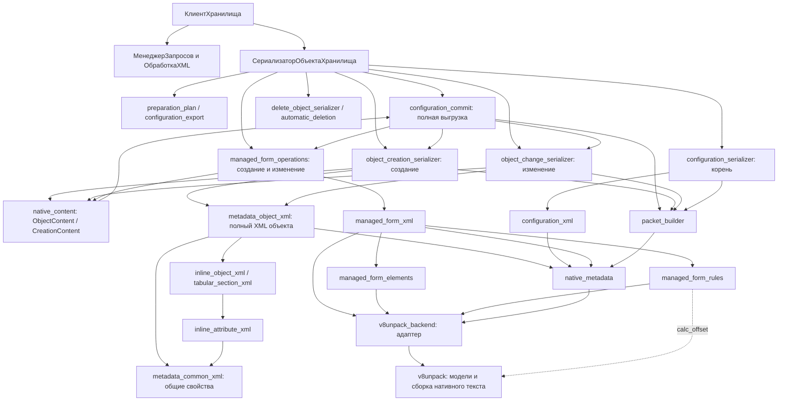

# Карта модулей

Файл формируется `tools/build_module_map.py`. Назначения модулей описаны в инструменте; связи извлекаются из текущих исходников. Проверка актуальности: `python tools/build_module_map.py --check`.

Таблицы показывают прямые вызовы между модулями производственного кода. В [машинной карте](module-map.json) перечислены вызываемые функции и отдельно импорты. Импорт сам по себе не означает вызов. Тесты, внешние библиотеки и файлы профилей JSON в таблицы модулей не включены.

Это статическая карта: вызовы через параметры, возвращённые объекты, динамические импорты и методы экземпляров полностью не разрешаются. Для OneScript учитываются имена из lib.config, конструкторы и имена Python-файлов в мосте; ссылки в комментариях и вызовы HTTP не считаются локальными вызовами модулей.

## Основные пути



Схема показывает основные этапы. Точный список прямых связей приведён ниже; пакет проходит через JSON-мост обратно в OneScript, после чего клиент отправляет его по HTTP. Подготовка пакета сама по себе не выполняет помещение.

`v8unpack_backend` использует модели v8unpack для разбора и сборки формы, определяет позиции полей элементов и собирает нативный текст. `managed_form_rules` также напрямую использует `v8unpack.helper.calc_offset`. Сопоставление XML Конфигуратора с этими моделями, привязки данных, контекст хранилища и пакеты помещения реализованы в наших модулях.

## Границы ответственности

- `native_metadata` не читает XML и не собирает операции помещения.
- `metadata_context` читает updateInfo; `serialization_context` сопоставляет его со снимком.
- XML-преобразователи возвращают нативное содержимое; сериализаторы операций собирают пакеты.
- `configuration_commit` координирует итоговую конфигурацию и связанные изменения.
- HTTP, захваты и подтверждение помещения принадлежат клиенту OneScript.

## Примеры преобразований

Примеры 1–4 исполняются последовательно из корня репозитория и проверяются тестом.
Они не обращаются к серверу и ничего не помещают в хранилище. Полные сигнатуры
и типы результатов приведены в таблице контрактов ниже.

### 1. XML свойства → нативные общие свойства

```python
from pathlib import Path
import sys
from xml.etree import ElementTree as E
sys.path.insert(0, str(Path("src/Сериализация").resolve()))
import metadata_common_xml as common
import metadata_object_xml as objects
import native_metadata as native
import type_description_xml as types
import v8unpack_backend as backend

oid = "11111111-1111-4111-8111-111111111111"
props = E.fromstring('''
<Properties xmlns="http://v8.1c.ru/8.3/MDClasses">
  <Name>Products</Name><Comment>before</Comment>
</Properties>
''')
name, group = common.read(props, oid)
assert name == "Products"
assert native.render(group) == (
    '{3,{1,0,11111111-1111-4111-8111-111111111111},'
    '"Products",{0},"before",0,0,00000000-0000-0000-0000-000000000000,0}'
)
```

Вход — Element с Name и Comment. Выход — имя и `Group`, а не XML-строка.
`native.render(group)` показывает эту группу в нативной записи 1С.

### 2. XML типа → Pattern → модель v8unpack → нативный текст

```python
type_xml = E.fromstring('''
<Type xmlns="http://v8.1c.ru/8.3/MDClasses"
      xmlns:v8="http://v8.1c.ru/8.1/data/core">
  <v8:Type>xs:string</v8:Type>
  <v8:StringQualifiers>
    <v8:Length>64</v8:Length><v8:AllowedLength>Variable</v8:AllowedLength>
  </v8:StringQualifiers>
</Type>
''')
pattern = types.read(type_xml)
assert native.render(pattern) == '{"Pattern",{"S",64,1}}'

model = backend.to_model(pattern)
assert model == ['"Pattern"', ['"S"', '64', '1']]
# assemble принимает список документов, поэтому модель обёрнута ещё в один список.
raw_pattern = backend.assemble([model])
assert native.render(native.Parser(raw_pattern.decode("utf-8-sig")).documents()[0]) == native.render(pattern)
assert native.inflate(native.compress(raw_pattern)) == raw_pattern
```

Здесь видна граница v8unpack: XML сначала преобразуется нашими правилами в
нативное дерево, затем адаптер передаёт сырую модель для сборки текста.
`64` в модели — строковый токен, а не Python int; кавычки вокруг строковых
значений тоже сохраняются в токенах.

### 3. Полный XML справочника → нативное тело

```python
xml_before = '''
<MetaDataObject xmlns="http://v8.1c.ru/8.3/MDClasses" version="2.21">
  <Catalog uuid="11111111-1111-4111-8111-111111111111">
    <Properties><Name>Products</Name><Comment>before</Comment></Properties>
    <ChildObjects/>
  </Catalog>
</MetaDataObject>
'''
object_id, object_name, raw_body, generated_ids = objects.create(
    xml_before, "8.5.1.1529", "Catalog"
)
assert (object_id, object_name) == (oid, "Products")
assert isinstance(raw_body, bytes)
assert len(generated_ids) == 10
assert len(set(generated_ids)) == 10
source = native.Parser(raw_body.decode("utf-8-sig")).documents()[0]
assert native.val(source[1][9][1][4]) == "before"
```

Выход — `(UUID, имя, bytes, список UUID)`. В примере отсутствует InternalInfo,
поэтому создаются десять новых UUID типов; их значения меняются при каждом запуске.
При переданном InternalInfo используются UUID из XML. `raw_body` — только
несжатое тело справочника: в нём ещё нет описания версии, графа помещения или HTTP.
Путь `[1][9][1][4]` здесь показан для проверенного профиля Catalog; общий код берёт
пути из профилей, не предполагая одинаковой структуры у всех классов.

### 4. Изменение полного XML → новое тело → обратная выгрузка

```python
xml_after = xml_before.replace("before", "after")
changed_body, feature_ids = objects.change(
    xml_after, "8.5.1.1529", "Catalog", source
)
changed = native.Parser(changed_body.decode("utf-8-sig")).documents()[0]
assert native.val(changed[1][9][1][4]) == "after"
assert feature_ids == []  # Встроенных реквизитов/табличных частей в примере нет.

tree = objects.export(changed, {}, "8.5.1.1529", "Catalog")
exported_xml = E.tostring(tree, encoding="unicode")
assert tree[0].get("uuid") == oid
assert tree[0].find(common.Q + "Properties/" + common.Q + "Comment").text == "after"
assert tree[0].find(common.Q + "InternalInfo") is not None
assert objects.create(exported_xml, "8.5.1.1529", "Catalog")[2] == changed_body
```

Для проверки изменения передаётся исходное нативное дерево. Если InternalInfo
в целевом XML отсутствует, прежние UUID типов сохраняются. `{}` при export —
пустое соответствие имён форм UUID. Выход export — Element, поэтому для файла
нужен tostring. Константы используют тот же механизм создания с kind="Constant";
помещение изменения существующей константы пока не объявлено поддержанным.

### 5. Файлы выгрузки → план подготовки

Схема вызова для реальной выгрузки и контекста сервера, не автономный пример:

```text
preparation_plan.plan({
  "xml_path": "C:/export/Catalogs/Products.xml",
  "context": "<Base64 updateInfo>",
  "options": {}
})
  ↓ dict
operation: "Создание" или "Изменение" — определяется по UUID и контексту
kind: "Catalog"
object_id: UUID из Products.xml
parent_id: UUID конфигурации
object_xml: полный текст Products.xml
forms: найденные файлы новых форм при создании владельца
modules / inline_modules: найденные полные тексты модулей
removed_ids: UUID отсутствующих отдельно хранимых детей при изменении
```

Если передан XML описания формы, план отдельно читает соседние Ext/Form.xml и
Ext/Form/Module.bsl; они попадают в form_xml и module_text. Сам план не содержит
готового нативного тела или пакета помещения.

### 6. Полная управляемая форма → два нативных потока

```text
managed_form_operations.create_native(
  kind="Catalog", name="ItemForm", platform="8.5.1.1529",
  owner=<нативное дерево справочника>,
  definition_xml=<текст Forms/ItemForm.xml>,
  interface_xml=<весь Forms/ItemForm/Ext/Form.xml>,
  module_text=<весь Forms/ItemForm/Ext/Form/Module.bsl>,
  references=<разрешённые ссылки на типы метаданных>
)
  ↓ tuple
(form_uuid, body_bytes, interface_bytes)
```

body_bytes описывает объект формы, interface_bytes содержит интерфейс и текст
её модуля. При изменении managed_form_xml.convert получает прежний нативный поток
и возвращает новый полный поток. Обработчики managed_form_operations.create и
managed_form_operations.change дополнительно собирают пакет, используя снимки,
контекст и при необходимости пакет текущей версии. Для полной папки используется
compile_change: результат ObjectContent содержит docs, body, streams, externals
без промежуточного пакета. Создание с contents_only=True возвращает
CreationContent(objects, version_code), где objects сопоставляет UUID с
ObjectContent. Общий JSON-вход serialize
выбирает обработчик по operation="Создание" или operation="Изменение".
create_native этого не делает. Добавление отдельного поля по attribute_name
не поддерживается: для изменения интерфейса нужен полный Form.xml.

### 7. Нативные тела → пакет → JSON-мост → HTTP

```text
packet_builder.assemble(
  graph=<нативный граф помещения>,
  objects=[ObjectRecord(
    object_id=<UUID>, metadata=<нативное описание, bytes>,
    body=<сжатое тело, bytes>, externals=<внешние потоки>
  )]
)
  ↓ bytes двоичного пакета
Base64 для поля data в JSON
  ↓
СериализаторОбъектаХранилища: ПакетПомещенияОбъекта
  ↓ только при вызове КлиентХранилища.ПоместитьПакет
HTTP-запрос к серверу хранилища и проверка результата
```

Нельзя передать raw_body из примера 3 вместо пакета: assemble требует ещё граф
помещения и описания объектов. Одни сериализаторы возвращают data и descriptions,
другие request_xml, из которого OneScript извлекает данные пакета. Поэтому
результаты разных сериализаторов нельзя считать одинаковыми словарями.

Обёртка JSON CLI добавляет ok к результату обработчика. Например:

```json
{"ok": true, "request_xml": "<XML запроса, содержащий Base64 пакета>"}
```

При ошибке проверки входа:

```json
{"ok": false, "error": "описание ошибки"}
```

Это формат файлового моста Python, не ответ HTTP-сервера хранилища.
Вызов функции serialize напрямую не добавляет поле ok.

## Контракты основных функций

Сигнатуры извлекаются из исходников при построении карты. Group/Atom — нативное дерево; Element — узел XML; bytes — двоичные данные; Base64 — строка для JSON-моста. Кортежи перечислены в порядке возвращаемых значений.

| Функция | Что подаётся на вход | Что возвращается |
| --- | --- | --- |
| `metadata_common_xml.read(props, oid, platform='8.5.1.1529')` | Properties как Element + UUID объекта. | (имя, common): строка и нативная группа общих свойств. |
| `metadata_common_xml.write(props, common)` | Element Properties + нативная группа common. | None; свойства добавляются в переданный Element. |
| `opaque_owner_references.equivalent_roots(before, after, kind, objects, reference_objects=None, *, body=None)` | Исходный и целевой XML владельца, класс, исходный контекст, итоговый индекс имён и необязательное нативное тело. | (before, after): XML для сравнения с UUID вместо изменённых известных ссылок; при подмене цели, имени или нативного UUID — ошибка. Тела и исходные XML не изменяются. |
| `metadata_owner_profiles.owner_profiles()` | Нет аргументов; проверенные JSON-профили владельцев форм и непрозрачных контейнеров. | Словарь по классу: например ExternalDataSource с путями общих свойств, UUID и коллекций Cube/Table. |
| `metadata_owner_change.serialize(request, native_content=False, *, reference_objects=None)` | request с полными object_xml/before_xml, классом, UUID, снимком, контекстом и исходной версией; native_content=True во внутренней сборке. | ObjectContent с телом и сохранёнными потоками, либо XML-запрос одиночного помещения; неизвестные изменения свойств отклоняются. |
| `type_description_xml.read(node)` | Element Type из XML Конфигуратора. | Group: например {"Pattern",{"S",64,1}}. |
| `type_description_xml.export(pattern, tag)` | Нативный Pattern + полное XML-имя тега. | Element Type с типом и квалификаторами. |
| `metadata_object_xml.object_xml(text, platform, kind, objects=None, *, type_references=None, allocation=None, xdto_types=None)` | Полный XML-строка, платформа, класс, индекс ссылок при необходимости. | (UUID, имя, native_body: bytes, generated_ids: list[str]). |
| `metadata_object_xml.create(text, platform, kind, forms=None, objects=None, parent=s.ZERO, reference_objects=None, templates=None, *, type_references=None, allocation=None, xdto_types=None)` | Полный XML, платформа, класс; UUID новых форм и макетов, индекс объектов при необходимости. | Тот же кортеж; коллекции новых форм и макетов уже включены в тело владельца. Пакета помещения ещё нет. |
| `metadata_object_xml.change(text, platform, kind, source, forms=None, removed=(), *, objects=None, metadata=None, reference_objects=None, type_references=None, xdto_types=None, allow_rename=False)` | Целевой полный XML, платформа, класс, исходное нативное дерево; контекст и удаления при необходимости. | (native_body: bytes, feature_ids: list[str]); защищённые части исходного тела проверяются. |
| `metadata_object_xml.export(source, forms, platform, kind, *, objects=None, type_references=None, xdto_types=None)` | Нативное дерево, соответствие имён форм UUID, платформа и класс. | Element MetaDataObject; для текста нужен ElementTree.tostring. Непредставимые поля не отбрасываются молча. |
| `inline_attribute_xml.attribute_xml(node, template=None, *, type_references=None, filling=True, property_names=None, xml_name='Attribute')` | Element Attribute + проверенный нативный шаблон. | (UUID, имя, нативное дерево встроенного реквизита). |
| `tabular_section_xml.read(node, owner_name, previous=None, kind='Catalog', *, type_references=None)` | Element TabularSection, имя владельца, прежнее тело при изменении, класс владельца. | (UUID, имя, нативное дерево, UUID признаков, сгенерированные UUID типов). |
| `form_definition_xml.read(text, kind, platform)` | XML описания формы, класс владельца и платформа. | (UUID формы, имя, common). Это описание формы, а не Ext/Form.xml. |
| `managed_form_xml.convert(raw, form_xml=None, module_text=None, paths=None, object_name=None, kind='Catalog', configuration_id=None)` | Прежний нативный поток интерфейса; полный Form.xml, текст модуля и привязки владельца. | bytes: полный новый нативный поток управляемой формы. |
| `managed_form_operations.create_native(kind, name, platform, owner, definition_xml=None, interface_xml=None, module_text=None, references=None, configuration_id=None)` | Класс и имя формы, платформа, нативное дерево владельца; описание, интерфейс, модуль и ссылки. | (UUID формы, body: bytes, interface: bytes). Описание и интерфейс — разные потоки. |
| `v8unpack_backend.to_model(node)` | Нативное дерево Group/Atom. | Вложенные list[str] в сыром формате v8unpack; кавычки остаются частью строковых токенов. |
| `v8unpack_backend.assemble(model)` | Сырая модель list[str]/вложенных списков, список корневых документов. | bytes: нативный текст; не XML Конфигуратора и не пакет хранилища. |
| `native_metadata.compress(data)` | bytes нативного содержимого. | bytes сжатого содержимого; для обратного преобразования inflate. |
| `metadata_context.context_objects(encoded)` | Base64-строка контекста updateInfo. | dict[UUID, documents]; documents = [metadata, permissions, external_map]. |
| `serialization_context.read(request, oid, size_error='Oversized snapshot input', mismatch_error='Snapshot/context mismatch', snapshot_key='snapshot')` | request со snapshot/context в Base64 + UUID объекта. | SnapshotContext: saved, docs, data, context. data — сжатое тело объекта. |
| `native_references.catalog(request)` | request с исходным context; внутри общей сборки — каталог итоговых объектов и подготовленных определений. | Catalog: итоговая цель, подготовленное или исходное тело; source_files читает исходные тела и потоки одной операцией с проверкой версий, даже при наличии подготовленных целей. |
| `metadata_object_xml.allocate_creation(text, platform, kind)` | Полный XML нового объекта, платформа и класс. | TypeAllocation: UUID объекта и заранее выделенные UUID типов; декларация доступна до преобразования тел, включая взаимные ссылки. |
| `metadata_object_xml.reference_dependencies(source, layout, oid)` | Нативное тело владельца, его профиль и UUID. Например, BasedOn содержит UUID другого документа и UUID самого владельца. | dict[UUID, flag]: {UUID другого документа: 0}; самоссылка остаётся в теле, но исключается из зависимостей правилом профиля. Один читатель используется для создания, изменения и сверки прежних ссылок. |
| `metadata_type_references.resolve(xml, request)` | Полный XML объекта и request с итоговым каталогом типов или исходным context/snapshots/storage. | dict: например cfg:CatalogRef.Товары → UUID ссылочного типа, а не UUID справочника. |
| `metadata_type_references.reference_definition(value)` | cfg:CatalogObject.Товары из свойства Source подписки. | (Catalog, Товары, Object): класс, имя и категория сгенерированного типа; категория Ref имеет другой UUID. |
| `metadata_type_sets.dependencies(names, reader, storage=None)` | Имена {cfg:CatalogObject} и каталог с проверенным снимком или хранилищем версий корня. | {UUID экземпляра раздела Main текущей конфигурации}; UUID берётся из нативного тела и сверяется с картой внутренних элементов корня. |
| `metadata_type_references.reconcile(request, source, target, layout, relations, oid, xml)` | Исходное и целевое нативные тела, профиль, исходные связи и полный целевой XML. | dict связей: исчезнувшие зависимости проверенных типов и свойств удалены; действующие и непрозрачные связи сохранены. |
| `metadata_type_references.source_owners(request, source, layout, relations, oid, *, strict=True)` | Исходное нативное тело, профиль, связи, UUID владельца и проверенные снимки/пакет версии. | set UUID: зависимости, подтверждённые сопоставленными свойствами или UUID типов. Создание формы использует этот же источник проверки родителя. |
| `external_data.extract_many(data, object_ids=None)` | Байты пакета текущей версии и необязательный набор UUID объектов. | dict UUID → тело, версии и внешние потоки; индекс и SHA-1 манифест проверяются один раз. |
| `external_dependencies.validate(request, objects, removed, targets, changed)` | Исходные объекты, удаления, исчезающие UUID и окончательные тела/потоки изменённых объектов. | None либо ошибка до упаковки: сохранённые потоки форм/СКД не могут ссылаться на удаляемые объекты, их типы и значения. |
| `type_description_xml.read_metadata(node, references=None)` | Element Type и словарь разрешённых ссылок cfg:… → UUID. | Общий Pattern скалярного, ссылочного или составного типа; квалификаторы проверяются для каждой ветви. |
| `type_description_xml.export_metadata(pattern, tag, references=None)` | Pattern, XML-тег и словарь имён ссылочных типов. | Element Type; обратное преобразование проверяется повторным чтением. |
| `metadata_object_xml.prepare_creation(text, platform, kind, forms, objects, parent, reference_objects, templates, type_references=None, allocation=None, xdto_types=None)` | Полный XML нового владельца, платформа, класс, UUID его форм/макетов и итоговый индекс. | PreparedCreation: неизменяемое определение со сгенерированными UUID типов, проверяемое при повторном использовании. |
| `preparation_plan.plan(request, object_xml=None, *, batch_relations=False, complete_export=False)` | xml_path, context в Base64, options; соседние файлы читаются с диска. | dict с operation, kind, object_id, parent_id, object_xml, form_xml, module_text, forms, templates, modules, inline_modules, file_data, removed_ids. |
| `object_file_content.companion(path, kind, definition)` | Путь XML, класс и полный текст описания; профили задают имена обязательных файлов в Ext/. | dict роль файла → полные байты в Base64; содержимое и пространство имён проверены. Например Package → байты Package.bin. |
| `object_file_content.convert(kind, definition, data, request=None)` | Класс, XML описания, file_data: роль файла → Base64 и запрос с XML-определениями для файлов со ссылками. | dict роль файла → Content(data, relations): нативные байты и контролируемые файлом связи либо None. XDTO переносится побайтно, Rights.xml компилируется целиком. |
| `object_file_content.definition_context(path, kind, data, request)` | Путь описания, класс, file_data и общий запрос подготовки; для роли доступна иерархическая XML-выгрузка. | metadata_definitions: JSON-описания только упомянутых объектов, полей RLS и предков. Полный экспорт передаёт общий итоговый индекс без повторного чтения папки. |
| `metadata_value_list_xml.read(node, rule, objects, scopes)` | Element списка значений, профиль, индекс объектов и области пространств имён XML. | (references, strings): UUID выбранных объектов и строковые значения; подписи и ненулевые флажки не поддерживаются. |
| `xdto_type_xml.read(node, namespaces, available=None)` | Element QName и его локальные объявления xmlns. | Нативное [0, URI, имя] для типа из проверенного каталога; неизвестный тип или несвязанный префикс отклоняется. |
| `xdto_packages.from_export(directory, inventory)` | Папка полной целевой выгрузки и её инвентаризация. | Catalog: UUID, пространства имён, объявления типов, импорты и SHA-256 полных файлов Package.bin. |
| `xdto_packages.from_storage(request)` | request с context и storage текущей версии в Base64. | Catalog только из потоков .0, для которых совпали объект, версия тела и версии всех внешних потоков. |
| `role_rights_native.read(node)` | AST нативной таблицы: версия 0 и пары UUID/состояние либо версия 1, число прав, пары и матрицы ограничений. | Table: состояния, полные матрицы условий и признак расширенного формата; write восстанавливает AST без потери условий. Это ещё не преобразователь Rights.xml. |
| `role_restrictions_xml.matrix(nodes, resolve_field=None)` | Полный список restrictionByCondition одного права; resolve_field(name) возвращает нативный путь из контекста метаданных. | Матрица {число строк, {1, текст условия, число полей, пути...}, ...}; для ограничений только на поля добавляется строка для остальных полей. |
| `role_restrictions_xml.templates(nodes)` | Полный список restrictionTemplate роли: name и condition из Rights.xml. | Нативный список {число шаблонов, {имя, полный текст}, ...}; используется общий кодек переводов строк. |
| `metadata_definitions.from_inventory(inventory)` | Полная инвентаризация целевой XML-выгрузки с узлами, UUID и владельцами хранимых объектов. | Index всех хранимых и вложенных элементов: полное имя, реальный UUID, родитель и stored_id тела. Вложенные элементы не выдаются за записи хранилища. |
| `role_metadata_context.Context.reference(self, name)` | Полное XML-имя, например Catalog.Items.Attribute.Text или Catalog.Items.StandardAttribute.Code, и итоговые определения. | Обычный заголовок {1, UUID элемента, 0, признак поля}; стандартный — {1, UUID владельца, 1, {-2, UUID класса стандартных полей}, 1}. reference_name проверяет и восстанавливает имя. |
| `role_metadata_context.Context.definition(self, name)` | XML-имя обычного элемента либо стандартного реквизита. | Реальное Definition элемента или владельца стандартного поля: отрицательный код и UUID класса не превращаются в фиктивное определение метаданных. |
| `role_metadata_context.Context.field_path(self, owner, name)` | Владелец и обычное, стандартное или вложенное поле табличной части: Catalog.Items / Code либо Rows.Amount. | Обычный путь {{0},{0,UUID поля}}, стандартный {{0},{-2}}, вложенный {{0,UUID табличной части},{0,UUID реквизита}}. Проверяются полный путь владения, класс и реальные UUID. |
| `role_right_identifiers.right_id(name)` | XML-имя права, например ThinClient. | Проверенный UUID 3c00c6ee-844e-4620-85e4-671e72f114d9; right_name выполняет обратное преобразование. Неизвестное право вызывает ошибку. |
| `role_dependencies.expand(plan, target, objects, directory, baseline_directory)` | План полной конфигурации, итоговый XML-инвентарь, исходные описатели и каталоги выгрузок. | Дополнительные операции изменения ролей, ссылающихся на исчезнувшие UUID; changed_files пуст, reason=metadata_reference_changed. Их целый Rights.xml пересобирается обычным путём без записи правок в XML. |
| `role_rights_xml.compile(raw, context=None)` | Полный Ext/Rights.xml и Context итоговых XML-определений: объекты, права, ограничения, шаблоны и три флага. | Нативный поток версии 10: обычные и 61 стандартная ссылка, 59 стандартных полей RLS и реквизиты табличной части по пути Rows.Amount. Номер строки табличной части и более глубокие пути пока не подключены. |
| `role_rights_native.file_references(raw)` | Полные байты нативного потока прав роли. | UUID объектов и обычных полей RLS для связей и защиты удаления. Стандартное поле зависит от UUID владельца; отрицательные коды, UUID класса и UUID в запросах не становятся метаданными. |
| `xml_namespaces.serialize(root)` | Element полного XML или фрагмента, включая буквальные CR в текстовых значениях. | Строка XML с CR как &#13;. При переписывании дерева с текстовыми QName используется render с областями пространств имён. |
| `xml_namespaces.parse(text)` | Полный XML-текст. | (Element, dict Element → действующие объявления xmlns): локальные переопределения префиксов сохраняются. |
| `configuration_export.plan(request)` | directory, baseline_directory и context в Base64. | dict: operations, removed_ids, new_ids, xml_paths, отпечатки файлов и счётчики. |
| `configuration_commit.prepare(request)` | Полная целевая и исходная выгрузки, context и platform. | (plan, changes): план с snapshot_ids/needs_storage и подготовленные изменения. |
| `object_creation_serializer.serialize(request, *, reference_objects=None, batch_relations=False, contents_only=False, definition=None)` | request: object_type задаёт класс, object_xml — полный XML; context и snapshots описывают текущее хранилище. | dict: request_xml, data в Base64, object_id, descriptions, externals и сведения об исходных объектах. |
| `object_change_serializer.serialize(request, native_content=False, *, reference_objects=None)` | request: полный object_xml, snapshot/context в Base64, UUID, исходная версия и класс. | Обычно dict(request_xml, external_owners). При native_content=True: ObjectContent(docs, body, streams, externals). |
| `configuration_serializer.serialize(request)` | request с XML корня и актуальными snapshot/context. | (request_xml: str, native_body: bytes). JSON CLI возвращает только request_xml. |
| `managed_form_operations.create(request, *, owner_body=None, contents_only=False)` | request: снимок/контекст владельца, имя и файлы новой формы. | dict: data в Base64, object_id, descriptions, externals; включает новую форму и изменение владельца. |
| `managed_form_operations.change(request, *, owner_body=None)` | request: snapshot, context и пакет версии storage в Base64; definition_xml, form_xml, module_text. | dict: data в Base64, object_id, class_id, original, local, external_name, external_version. |
| `managed_form_operations.compile_change(request, *, owner_body=None)` | Тот же request и необязательное итоговое тело владельца. | ObjectContent: docs, body, streams, externals; версии самого объекта ещё не изменены, пакет не собирается. |
| `commonmodule_serializer.compile_change(request)` | request: полный object_xml, source_text и проверенные snapshot/context. | ObjectContent с нативным телом модуля и заменённым внешним текстом; пакет не собирается. |
| `template_serializer.compile_change(request)` | request: definition_xml, содержимое макета, snapshot/context и storage. | ObjectContent с описанием и полным внешним потоком макета; пакет не собирается. |
| `template_serializer.create(request, *, contents_only=False)` | request: снимок и контекст владельца, definition_xml и содержимое макета; storage для ссылок СКД. | Одиночный пакет или, при contents_only=True, CreationContent с одним новым ObjectContent без промежуточной упаковки. |
| `managed_form_operations.serialize(request, *, owner_body=None)` | request с обязательным operation: Создание или Изменение; остальные поля зависят от операции. | Результат create или change. Это общий вход JSON CLI, без определения операции по косвенным признакам. |
| `delete_object_serializer.serialize(request)` | request с UUID удаления, снимками объекта/родителя и полным целевым XML родителя. | dict: data в Base64, object_id, parent_id, removed_ids, descriptions, externals. |
| `configuration_commit.serialize(request)` | Полные выгрузки и контекст; snapshots по плану, storage при необходимости; версии и платформа. | dict: data, descriptions, requested, changed_ids, new_ids, removed_ids, externals и версии хранилища. |
| `packet_builder.assemble(graph, objects)` | Нативный граф помещения и ObjectRecord: UUID, metadata, сжатое body, внешние потоки. | bytes готового двоичного пакета помещения. Для JSON используется Base64. |
| `serializer_cli.run(handler)` | handler + пути входного и выходного JSON в argv. | Выходной файл: {ok: true, ...результат} либо {ok: false, error: ...}. |

## OneScript

| Модуль | Ответственность | Кто вызывает | Что вызывает |
| --- | --- | --- | --- |
| [ВерсияХранилища](../src/Классы/ВерсияХранилища.os) | Модель версии хранилища. | `КлиентХранилища` | `Вспомогательный` |
| [Вспомогательный](../src/Модули/Вспомогательный.os) | Служебные операции протокола и кодирования. | `ВерсияХранилища`, `КлиентХранилища`, `МенеджерХранилищ`, `ОбработкаXML`, `ПользовательХранилища` | — |
| [ИдентификаторыМетаданных](../src/Модули/ИдентификаторыМетаданных.os) | Доступ OneScript к UUID классов и коллекций. | `КлиентХранилища`, `ПакетПомещенияОбъекта`, `ПравилаПакетовХранилища`, `СериализаторОбъектаХранилища` | — |
| [КлиентХранилища](../src/Классы/КлиентХранилища.os) | HTTP-вызовы: снимки, захваты, подготовка, помещение и проверки результата. | — | `ВерсияХранилища`, `Вспомогательный`, `ИдентификаторыМетаданных`, `МенеджерЗапросов`, `ОбработкаXML`, `ПользовательХранилища`, `ПравилаПакетовХранилища`, `СериализаторОбъектаХранилища`, `СовместимостьПлатформы` |
| [МенеджерЗапросов](../src/Модули/МенеджерЗапросов.os) | Формирование XML-запросов протокола хранилища. | `КлиентХранилища`, `МенеджерХранилищ` | `СовместимостьПлатформы` |
| [МенеджерХранилищ](../src/Модули/МенеджерХранилищ.os) | Операции сервера и управление хранилищами. | — | `Вспомогательный`, `МенеджерЗапросов`, `ОбработкаXML` |
| [ОбработкаXML](../src/Модули/ОбработкаXML.os) | Разбор ответов сервера, контекста и описаний объектов. | `КлиентХранилища`, `МенеджерХранилищ` | `Вспомогательный`, `ОбъектХранилища`, `ОтветСервиса`, `СнимокОбъектаХранилища` |
| [ОбъектХранилища](../src/Классы/ОбъектХранилища.os) | Описание объекта и проверки допустимости операций. | `ОбработкаXML`, `ПравилаПакетовХранилища` | — |
| [ОтветСервиса](../src/Классы/ОтветСервиса.os) | Модель ответа сервера и его ошибок. | `ОбработкаXML` | — |
| [ПакетПомещенияОбъекта](../src/Классы/ПакетПомещенияОбъекта.os) | Модель пакета, его импорт и проверка состава. | `СериализаторОбъектаХранилища` | `ИдентификаторыМетаданных`, `ПравилаПакетовХранилища`, `СериализаторОбъектаХранилища`, `СовместимостьПлатформы` |
| [ПараметрыСозданияХранилища](../src/Классы/ПараметрыСозданияХранилища.os) | Параметры создания нового хранилища. | — | — |
| [ПользовательХранилища](../src/Классы/ПользовательХранилища.os) | Описание пользователя хранилища. | `КлиентХранилища` | `Вспомогательный`, `РолиХранилища` |
| [ПравилаПакетовХранилища](../src/Модули/ПравилаПакетовХранилища.os) | Правила операций и состава пакетов по классам объектов. | `КлиентХранилища`, `ПакетПомещенияОбъекта`, `СериализаторОбъектаХранилища` | `ИдентификаторыМетаданных`, `ОбъектХранилища` |
| [РолиХранилища](../src/Модули/РолиХранилища.os) | Роли и права пользователей хранилища. | `ПользовательХранилища` | — |
| [СериализаторОбъектаХранилища](../src/Модули/СериализаторОбъектаХранилища.os) | Подготовка JSON для Python и импорт подготовленных пакетов. | `КлиентХранилища`, `ПакетПомещенияОбъекта` | `ИдентификаторыМетаданных`, `ПакетПомещенияОбъекта`, `ПравилаПакетовХранилища`, `automatic_deletion`, `commonmodule_serializer`, `configuration_batch`, `configuration_commit`, `configuration_export`, `configuration_serializer`, `delete_object_serializer`, `external_data`, `managed_form_operations`, `metadata_classes`, `metadata_references`, `object_change_serializer`, `object_creation_serializer`, `preparation_plan`, `template_serializer` |
| [СнимокОбъектаХранилища](../src/Классы/СнимокОбъектаХранилища.os) | Снимок объекта и версия хранилища, на которой он прочитан. | `ОбработкаXML` | — |
| [СовместимостьПлатформы](../src/Модули/СовместимостьПлатформы.os) | Проверка поддерживаемого профиля платформы. | `КлиентХранилища`, `МенеджерЗапросов`, `ПакетПомещенияОбъекта` | — |

## Python

| Модуль | Ответственность | Кто вызывает | Что вызывает |
| --- | --- | --- | --- |
| [appearance_xml](../src/Сериализация/appearance_xml.py) | Цвета, шрифты и оформление элементов. | `managed_form_xml`, `metadata_object_xml`, `metadata_references` | `native_metadata`, `xml_namespaces` |
| [automatic_deletion](../src/Сериализация/automatic_deletion.py) | Поиск отсутствующих детей и сборка изменения с удалениями. | `СериализаторОбъектаХранилища`, `configuration_commit`, `delete_object_serializer`, `metadata_owner_change`, `object_change_serializer`, `preparation_plan` | `configuration_xml`, `external_dependencies`, `metadata_context`, `metadata_identifiers`, `metadata_owner_change`, `metadata_structure`, `metadata_targets`, `native_collection_editor`, `native_content`, `native_metadata`, `object_change_serializer`, `object_xml_profiles`, `packet_builder`, `platform_profiles`, `serialization_context`, `serializer_cli`, `xml_namespaces` |
| [child_object_xml](../src/Сериализация/child_object_xml.py) | Ссылки владельца на отдельно хранимые дочерние объекты. | `metadata_object_xml` | `metadata_context`, `metadata_identifiers`, `metadata_targets`, `native_metadata` |
| [choice_list_xml](../src/Сериализация/choice_list_xml.py) | Списки выбора и их значения. | `managed_form_rules` | `managed_form_elements`, `native_metadata`, `picture_xml`, `typed_value_xml` |
| [commonmodule_serializer](../src/Сериализация/commonmodule_serializer.py) | Изменение общего модуля, включая его текст и описание. | `СериализаторОбъектаХранилища`, `configuration_commit`, `object_change_serializer`, `object_creation_serializer` | `metadata_identifiers`, `metadata_object_xml`, `native_content`, `native_metadata`, `packet_builder`, `platform_profiles`, `serialization_context`, `serializer_cli`, `xml_namespaces` |
| [configuration_batch](../src/Сериализация/configuration_batch.py) | Объединение подготовленных изменений в один пакет. | `СериализаторОбъектаХранилища` | `external_data`, `metadata_context`, `native_metadata`, `packet_builder`, `serializer_cli` |
| [configuration_commit](../src/Сериализация/configuration_commit.py) | Подготовка полной выгрузки: создания, изменения, зависимости и удаления. | `СериализаторОбъектаХранилища` | `automatic_deletion`, `commonmodule_serializer`, `configuration_export`, `external_dependencies`, `form_dependencies`, `inline_command_xml`, `inline_object_xml`, `managed_form_operations`, `metadata_context`, `metadata_definitions`, `metadata_identifiers`, `metadata_object_xml`, `metadata_owner_change`, `metadata_owner_profiles`, `metadata_references`, `metadata_structure`, `metadata_targets`, `metadata_type_references`, `native_collection_editor`, `native_metadata`, `native_references`, `object_change_serializer`, `object_creation_serializer`, `object_xml_profiles`, `opaque_owner_references`, `packet_builder`, `platform_profiles`, `preparation_plan`, `role_dependencies`, `serialization_context`, `serializer_cli`, `template_references`, `template_serializer`, `xdto_packages`, `xml_namespaces` |
| [configuration_export](../src/Сериализация/configuration_export.py) | Инвентаризация файлов выгрузки и определение операций. | `СериализаторОбъектаХранилища`, `configuration_commit`, `form_dependencies`, `metadata_targets`, `object_file_content`, `preparation_plan`, `role_dependencies` | `metadata_context`, `metadata_structure`, `native_metadata`, `object_xml_profiles`, `preparation_plan`, `serializer_cli` |
| [configuration_serializer](../src/Сериализация/configuration_serializer.py) | Сборка пакета изменения корня конфигурации. | `СериализаторОбъектаХранилища` | `configuration_xml`, `metadata_context`, `native_metadata`, `packet_builder`, `platform_profiles`, `serializer_cli` |
| [configuration_xml](../src/Сериализация/configuration_xml.py) | Свойства корня конфигурации и преобразование его полного XML. | `automatic_deletion`, `configuration_serializer`, `managed_form_operations`, `metadata_type_sets`, `object_creation_serializer`, `template_serializer` | `metadata_common_xml`, `metadata_context`, `metadata_identifiers`, `metadata_structure`, `metadata_targets`, `native_metadata`, `platform_profiles`, `xml_namespaces` |
| [delete_object_serializer](../src/Сериализация/delete_object_serializer.py) | Сборка явного удаления объекта и изменения его владельца. | `СериализаторОбъектаХранилища` | `automatic_deletion`, `metadata_context`, `metadata_identifiers`, `metadata_structure`, `native_collection_editor`, `native_metadata`, `platform_profiles`, `serialization_context`, `serializer_cli` |
| [external_data](../src/Сериализация/external_data.py) | Чтение тел объектов и внешних потоков из пакета версии. | `СериализаторОбъектаХранилища`, `configuration_batch`, `external_dependencies`, `managed_form_operations`, `native_references`, `template_serializer` | `native_metadata`, `serializer_cli` |
| [external_dependencies](../src/Сериализация/external_dependencies.py) | Проверка итоговых потоков форм и СКД на ссылки к удаляемым объектам, типам и значениям. | `automatic_deletion`, `configuration_commit`, `object_change_serializer`, `preparation_plan` | `external_data`, `managed_form_xml`, `metadata_identifiers`, `metadata_object_xml`, `metadata_targets`, `native_metadata`, `native_references`, `object_xml_profiles`, `role_rights_native`, `schema_content`, `serialization_context`, `tabular_section_xml` |
| [form_attribute_types](../src/Сериализация/form_attribute_types.py) | Типы реквизитов формы, включая составные и коллекционные. | `metadata_references` | `metadata_context`, `metadata_identifiers`, `metadata_targets`, `native_metadata`, `native_references`, `object_xml_profiles` |
| [form_definition_xml](../src/Сериализация/form_definition_xml.py) | Описание формы: UUID, имя, свойства и нативное тело описания. | `managed_form_operations`, `object_creation_serializer` | `managed_form_profiles`, `metadata_common_xml`, `metadata_context`, `native_metadata`, `platform_profiles` |
| [form_dependencies](../src/Сериализация/form_dependencies.py) | Поиск форм, которые нужно пересобрать при изменении владельца. | `configuration_commit` | `configuration_export`, `managed_form_profiles`, `managed_form_xml`, `metadata_owner_change`, `native_collection_editor`, `native_metadata`, `preparation_plan`, `serialization_context` |
| [inline_attribute_xml](../src/Сериализация/inline_attribute_xml.py) | Общие свойства, типы и проверенные шаблоны встроенных реквизитов. | `inline_object_xml`, `metadata_object_xml`, `tabular_section_xml` | `metadata_common_xml`, `metadata_context`, `native_metadata`, `type_description_xml` |
| [inline_command_xml](../src/Сериализация/inline_command_xml.py) | Владение потоками модулей встроенных команд. | `configuration_commit`, `inline_object_xml`, `managed_form_operations`, `metadata_owner_change`, `object_change_serializer`, `object_creation_serializer`, `template_serializer` | `inline_metadata_xml`, `native_metadata`, `object_xml_profiles`, `packet_builder` |
| [inline_metadata_xml](../src/Сериализация/inline_metadata_xml.py) | Общие свойства и рекурсивные дочерние коллекции встроенных метаданных. | `inline_command_xml`, `inline_object_xml`, `metadata_object_xml` | `metadata_common_xml`, `metadata_context`, `metadata_localized_xml`, `native_metadata`, `type_description_xml`, `xdto_type_xml` |
| [inline_object_xml](../src/Сериализация/inline_object_xml.py) | Реквизиты, измерения, ресурсы и другие встроенные коллекции. | `configuration_commit`, `metadata_object_xml`, `object_change_serializer`, `object_creation_serializer` | `inline_attribute_xml`, `inline_command_xml`, `inline_metadata_xml`, `metadata_common_xml`, `native_metadata`, `tabular_section_xml`, `type_description_xml` |
| [managed_form_bindings](../src/Сериализация/managed_form_bindings.py) | Привязки данных формы к реквизитам и коллекциям владельца. | `managed_form_xml` | `managed_form_profiles`, `managed_form_xml`, `native_metadata`, `object_xml_profiles` |
| [managed_form_elements](../src/Сериализация/managed_form_elements.py) | Преобразование элементов управляемой формы. | `choice_list_xml`, `managed_form_rules`, `managed_form_xml`, `rich_text_xml` | `managed_form_rules`, `native_metadata`, `picture_xml`, `v8unpack_backend` |
| [managed_form_operations](../src/Сериализация/managed_form_operations.py) | Создание и изменение управляемой формы: версии, привязки, описание, интерфейс, модуль и пакет помещения. | `СериализаторОбъектаХранилища`, `configuration_commit`, `object_creation_serializer` | `configuration_xml`, `external_data`, `form_definition_xml`, `inline_command_xml`, `managed_form_profiles`, `managed_form_xml`, `metadata_context`, `metadata_identifiers`, `metadata_references`, `metadata_type_references`, `native_content`, `native_metadata`, `object_xml_profiles`, `packet_builder`, `platform_profiles`, `serialization_context`, `serializer_cli` |
| [managed_form_profiles](../src/Сериализация/managed_form_profiles.py) | Профили владельцев и структуры управляемых форм. | `form_definition_xml`, `form_dependencies`, `managed_form_bindings`, `managed_form_operations`, `managed_form_xml`, `metadata_object_xml`, `metadata_owner_profiles`, `metadata_targets`, `object_creation_serializer`, `object_xml_profiles`, `owned_form_properties`, `owned_forms`, `preparation_plan`, `template_serializer` | `managed_form_xml`, `native_metadata` |
| [managed_form_rules](../src/Сериализация/managed_form_rules.py) | Профильные правила свойств и событий формы и её элементов. | `managed_form_elements`, `managed_form_xml` | `choice_list_xml`, `managed_form_elements`, `native_metadata`, `rich_text_xml`, `v8unpack_backend` |
| [managed_form_xml](../src/Сериализация/managed_form_xml.py) | Преобразование полного Form.xml и текста модуля формы. | `external_dependencies`, `form_dependencies`, `managed_form_bindings`, `managed_form_operations`, `managed_form_profiles`, `metadata_references` | `appearance_xml`, `managed_form_bindings`, `managed_form_elements`, `managed_form_profiles`, `managed_form_rules`, `native_metadata`, `report_form_properties`, `tabular_section_xml`, `type_description_xml`, `v8unpack_backend` |
| [metadata_classes](../src/Сериализация/metadata_classes.py) | Получение справочника классов метаданных через Python-вход. | `СериализаторОбъектаХранилища` | `metadata_identifiers`, `native_metadata`, `serializer_cli` |
| [metadata_common_xml](../src/Сериализация/metadata_common_xml.py) | Прямое чтение и запись общих свойств метаданных без промежуточных объектов. | `configuration_xml`, `form_definition_xml`, `inline_attribute_xml`, `inline_metadata_xml`, `inline_object_xml`, `metadata_object_xml`, `metadata_owner_change`, `tabular_section_xml` | `metadata_localized_xml`, `native_metadata`, `platform_profiles` |
| [metadata_context](../src/Сериализация/metadata_context.py) | Чтение updateInfo, проверка UUID и карты отдельно хранимых детей. | `automatic_deletion`, `child_object_xml`, `configuration_batch`, `configuration_commit`, `configuration_export`, `configuration_serializer`, `configuration_xml`, `delete_object_serializer`, `form_attribute_types`, `form_definition_xml`, `inline_attribute_xml`, `inline_metadata_xml`, `managed_form_operations`, `metadata_definitions`, `metadata_field_lists`, `metadata_object_xml`, `metadata_owner_change`, `metadata_references`, `metadata_targets`, `metadata_type_references`, `native_collection_editor`, `native_references`, `object_change_serializer`, `object_creation_serializer`, `object_file_content`, `owned_form_properties`, `preparation_plan`, `role_dependencies`, `serialization_context`, `tabular_section_xml`, `template_serializer`, `xdto_packages` | `native_metadata` |
| [metadata_definitions](../src/Сериализация/metadata_definitions.py) | Итоговый индекс UUID и полных XML-имён всех хранимых и вложенных элементов; коллекции читаются из карты схемы без активации сериализаторов. | `configuration_commit`, `object_file_content`, `role_metadata_context` | `metadata_context`, `metadata_structure` |
| [metadata_field_lists](../src/Сериализация/metadata_field_lists.py) | Полные списки полей метаданных: стандартные селекторы и UUID собственных реквизитов для поиска и блокировок. | `metadata_object_xml` | `metadata_context`, `native_metadata`, `object_xml_profiles`, `type_description_xml` |
| [metadata_identifiers](../src/Сериализация/metadata_identifiers.py) | UUID классов, коллекций и служебных возможностей. | `automatic_deletion`, `child_object_xml`, `commonmodule_serializer`, `configuration_commit`, `configuration_xml`, `delete_object_serializer`, `external_dependencies`, `form_attribute_types`, `managed_form_operations`, `metadata_classes`, `metadata_object_xml`, `metadata_owner_change`, `metadata_references`, `metadata_targets`, `metadata_type_references`, `metadata_type_sets`, `metadata_value_list_xml`, `native_references`, `object_change_serializer`, `object_creation_serializer`, `object_file_content`, `opaque_owner_references`, `owned_forms`, `preparation_plan`, `related_object_changes`, `role_dependencies`, `template_serializer`, `xdto_packages` | — |
| [metadata_localized_xml](../src/Сериализация/metadata_localized_xml.py) | Многоязычные строки метаданных. | `inline_metadata_xml`, `metadata_common_xml`, `metadata_object_xml`, `template_serializer` | `native_metadata` |
| [metadata_object_xml](../src/Сериализация/metadata_object_xml.py) | Общий механизм создания и изменения нативного тела по полному XML; выгрузка поддержанных структур. | `commonmodule_serializer`, `configuration_commit`, `external_dependencies`, `metadata_type_references`, `native_references`, `object_change_serializer`, `object_creation_serializer`, `related_object_changes`, `template_references`, `xdto_packages` | `appearance_xml`, `child_object_xml`, `inline_attribute_xml`, `inline_metadata_xml`, `inline_object_xml`, `managed_form_profiles`, `metadata_common_xml`, `metadata_context`, `metadata_field_lists`, `metadata_identifiers`, `metadata_localized_xml`, `metadata_structure`, `metadata_targets`, `metadata_value_list_xml`, `native_collection_editor`, `native_metadata`, `object_xml_profiles`, `platform_profiles`, `tabular_section_xml`, `type_description_xml`, `typed_value_xml`, `xdto_type_xml`, `xml_namespaces` |
| [metadata_owner_change](../src/Сериализация/metadata_owner_change.py) | Общие свойства и отдельно хранимые коллекции существующего владельца при неполном XML-профиле. | `automatic_deletion`, `configuration_commit`, `form_dependencies`, `object_change_serializer` | `automatic_deletion`, `inline_command_xml`, `metadata_common_xml`, `metadata_context`, `metadata_identifiers`, `metadata_owner_profiles`, `metadata_structure`, `native_collection_editor`, `native_content`, `native_metadata`, `opaque_owner_references`, `owned_form_properties`, `packet_builder`, `serialization_context` |
| [metadata_owner_profiles](../src/Сериализация/metadata_owner_profiles.py) | Общий реестр проверенных нативных структур владельцев, включая контейнеры без форм. | `configuration_commit`, `metadata_owner_change`, `preparation_plan` | `managed_form_profiles`, `native_collection_editor` |
| [metadata_references](../src/Сериализация/metadata_references.py) | Разрешение ссылок из формы и определение требуемых снимков. | `СериализаторОбъектаХранилища`, `configuration_commit`, `managed_form_operations`, `object_creation_serializer` | `appearance_xml`, `form_attribute_types`, `managed_form_xml`, `metadata_context`, `metadata_identifiers`, `metadata_targets`, `native_metadata`, `native_references`, `serializer_cli`, `typed_value_xml` |
| [metadata_structure](../src/Сериализация/metadata_structure.py) | Карта классов, дочерних коллекций и их правил хранения. | `automatic_deletion`, `configuration_commit`, `configuration_export`, `configuration_xml`, `delete_object_serializer`, `metadata_definitions`, `metadata_object_xml`, `metadata_owner_change`, `metadata_targets`, `native_collection_editor`, `object_change_serializer`, `object_xml_profiles`, `preparation_plan`, `template_serializer` | — |
| [metadata_targets](../src/Сериализация/metadata_targets.py) | Индекс текущих и итоговых объектов для разрешения ссылок. | `automatic_deletion`, `child_object_xml`, `configuration_commit`, `configuration_xml`, `external_dependencies`, `form_attribute_types`, `metadata_object_xml`, `metadata_references`, `metadata_value_list_xml`, `native_references`, `object_creation_serializer`, `opaque_owner_references`, `owned_form_properties` | `configuration_export`, `managed_form_profiles`, `metadata_context`, `metadata_identifiers`, `metadata_structure`, `native_metadata` |
| [metadata_type_references](../src/Сериализация/metadata_type_references.py) | Ссылочные типы свойств Type: сопоставление XML-имён с UUID типов итоговой конфигурации. | `configuration_commit`, `managed_form_operations`, `object_change_serializer`, `object_creation_serializer`, `preparation_plan`, `related_object_changes` | `metadata_context`, `metadata_identifiers`, `metadata_object_xml`, `metadata_type_sets`, `native_metadata`, `native_references`, `object_xml_profiles`, `serialization_context`, `type_description_xml` |
| [metadata_type_sets](../src/Сериализация/metadata_type_sets.py) | Проверенные групповые типы платформы: XML TypeSet, постоянные UUID и запрет их подмены. | `metadata_type_references`, `type_description_xml` | `configuration_xml`, `metadata_identifiers`, `native_metadata` |
| [metadata_value_list_xml](../src/Сериализация/metadata_value_list_xml.py) | Полный список значений свойства метаданных: ссылки на объекты и строки в раздельных нативных коллекциях. | `metadata_object_xml`, `xdto_packages` | `metadata_identifiers`, `metadata_targets`, `native_metadata`, `typed_value_xml`, `xml_namespaces` |
| [native_collection_editor](../src/Сериализация/native_collection_editor.py) | Изменение нативных коллекций по карте метаданных. | `automatic_deletion`, `configuration_commit`, `delete_object_serializer`, `form_dependencies`, `metadata_object_xml`, `metadata_owner_change`, `metadata_owner_profiles`, `object_change_serializer`, `object_creation_serializer`, `opaque_owner_references` | `metadata_context`, `metadata_structure`, `native_metadata`, `xml_namespaces` |
| [native_content](../src/Сериализация/native_content.py) | Общий результат преобразования: метаданные, тело, потоки и их версии; без упаковки пакета. | `automatic_deletion`, `commonmodule_serializer`, `managed_form_operations`, `metadata_owner_change`, `object_change_serializer`, `object_creation_serializer`, `template_serializer` | `packet_builder` |
| [native_metadata](../src/Сериализация/native_metadata.py) | Нативное дерево, текст, двоичные записи, сжатие и контейнер хранилища. | `appearance_xml`, `automatic_deletion`, `child_object_xml`, `choice_list_xml`, `commonmodule_serializer`, `configuration_batch`, `configuration_commit`, `configuration_export`, `configuration_serializer`, `configuration_xml`, `delete_object_serializer`, `external_data`, `external_dependencies`, `form_attribute_types`, `form_definition_xml`, `form_dependencies`, `inline_attribute_xml`, `inline_command_xml`, `inline_metadata_xml`, `inline_object_xml`, `managed_form_bindings`, `managed_form_elements`, `managed_form_operations`, `managed_form_profiles`, `managed_form_rules`, `managed_form_xml`, `metadata_classes`, `metadata_common_xml`, `metadata_context`, `metadata_field_lists`, `metadata_localized_xml`, `metadata_object_xml`, `metadata_owner_change`, `metadata_references`, `metadata_targets`, `metadata_type_references`, `metadata_type_sets`, `metadata_value_list_xml`, `native_collection_editor`, `native_references`, `object_change_serializer`, `object_creation_serializer`, `object_file_content`, `object_graph`, `opaque_owner_references`, `owned_form_properties`, `owned_forms`, `packet_builder`, `picture_xml`, `preparation_plan`, `related_object_changes`, `report_form_properties`, `rich_text_xml`, `role_dependencies`, `role_metadata_context`, `role_restrictions_xml`, `role_rights_native`, `role_rights_xml`, `schema_content`, `serialization_context`, `tabular_section_xml`, `template_content`, `template_references`, `template_serializer`, `type_description_xml`, `v8unpack_backend`, `xdto_packages`, `xdto_type_xml` | `v8unpack_backend` |
| [native_references](../src/Сериализация/native_references.py) | Итоговые ссылки на типы и значения: подготовленные нативные определения либо проверенные исходные снимки/пакет версии. | `configuration_commit`, `external_dependencies`, `form_attribute_types`, `metadata_references`, `metadata_type_references`, `object_creation_serializer`, `template_references`, `xdto_packages` | `external_data`, `metadata_context`, `metadata_identifiers`, `metadata_object_xml`, `metadata_targets`, `native_metadata`, `serialization_context` |
| [object_change_serializer](../src/Сериализация/object_change_serializer.py) | Сборка изменения существующего объекта по полному XML. | `СериализаторОбъектаХранилища`, `automatic_deletion`, `configuration_commit` | `automatic_deletion`, `commonmodule_serializer`, `external_dependencies`, `inline_command_xml`, `inline_object_xml`, `metadata_context`, `metadata_identifiers`, `metadata_object_xml`, `metadata_owner_change`, `metadata_structure`, `metadata_type_references`, `native_collection_editor`, `native_content`, `native_metadata`, `object_file_content`, `object_xml_profiles`, `packet_builder`, `serialization_context`, `serializer_cli`, `xdto_packages` |
| [object_creation_serializer](../src/Сериализация/object_creation_serializer.py) | Сборка создания объекта, его форм и связанных изменений. | `СериализаторОбъектаХранилища`, `configuration_commit` | `commonmodule_serializer`, `configuration_xml`, `form_definition_xml`, `inline_command_xml`, `inline_object_xml`, `managed_form_operations`, `managed_form_profiles`, `metadata_context`, `metadata_identifiers`, `metadata_object_xml`, `metadata_references`, `metadata_targets`, `metadata_type_references`, `native_collection_editor`, `native_content`, `native_metadata`, `native_references`, `object_file_content`, `object_graph`, `object_xml_profiles`, `packet_builder`, `platform_profiles`, `related_object_changes`, `serialization_context`, `serializer_cli`, `template_content`, `template_serializer`, `xdto_packages`, `xdto_type_xml` |
| [object_file_content](../src/Сериализация/object_file_content.py) | Полные сопутствующие файлы объекта: проверка, контекст XML-определений, нативные потоки и управляемые ими связи по профилю. | `object_change_serializer`, `object_creation_serializer`, `preparation_plan` | `configuration_export`, `metadata_context`, `metadata_definitions`, `metadata_identifiers`, `native_metadata`, `object_xml_profiles`, `role_metadata_context`, `role_rights_native`, `role_rights_xml`, `xdto_packages` |
| [object_graph](../src/Сериализация/object_graph.py) | Обход владения и замыкание зависимостей объектов. | `object_creation_serializer` | `native_metadata` |
| [object_xml_profiles](../src/Сериализация/object_xml_profiles.py) | Проверенные свойства, коллекции и модули классов объектов. | `automatic_deletion`, `configuration_commit`, `configuration_export`, `external_dependencies`, `form_attribute_types`, `inline_command_xml`, `managed_form_bindings`, `managed_form_operations`, `metadata_field_lists`, `metadata_object_xml`, `metadata_type_references`, `object_change_serializer`, `object_creation_serializer`, `object_file_content`, `preparation_plan`, `related_object_changes`, `tabular_section_xml`, `template_references`, `xdto_packages` | `managed_form_profiles`, `metadata_structure`, `owned_form_properties`, `platform_profiles` |
| [opaque_owner_references](../src/Сериализация/opaque_owner_references.py) | Проверка эквивалентности известных XML-ссылок неполных профилей при переименовании цели с сохранением нативного UUID. | `configuration_commit`, `metadata_owner_change` | `metadata_identifiers`, `metadata_targets`, `native_collection_editor`, `native_metadata` |
| [owned_form_properties](../src/Сериализация/owned_form_properties.py) | Назначения форм владельца: проверка ссылок и нативных полей. | `metadata_owner_change`, `object_xml_profiles` | `managed_form_profiles`, `metadata_context`, `metadata_targets`, `native_metadata` |
| [owned_forms](../src/Сериализация/owned_forms.py) | Чтение нативной коллекции форм владельца и определение позиций. | — | `managed_form_profiles`, `metadata_identifiers`, `native_metadata` |
| [packet_builder](../src/Сериализация/packet_builder.py) | Граф помещения, версии, записи объектов и итоговый XML-запрос. | `automatic_deletion`, `commonmodule_serializer`, `configuration_batch`, `configuration_commit`, `configuration_serializer`, `inline_command_xml`, `managed_form_operations`, `metadata_owner_change`, `native_content`, `object_change_serializer`, `object_creation_serializer`, `related_object_changes`, `template_serializer` | `native_metadata`, `xml_namespaces` |
| [picture_xml](../src/Сериализация/picture_xml.py) | Картинки и ссылки на них в формах. | `choice_list_xml`, `managed_form_elements`, `schema_content` | `native_metadata` |
| [platform_profiles](../src/Сериализация/platform_profiles.py) | Выбор профиля платформы и структуры выгрузки. | `automatic_deletion`, `commonmodule_serializer`, `configuration_commit`, `configuration_serializer`, `configuration_xml`, `delete_object_serializer`, `form_definition_xml`, `managed_form_operations`, `metadata_common_xml`, `metadata_object_xml`, `object_creation_serializer`, `object_xml_profiles`, `template_serializer` | — |
| [preparation_plan](../src/Сериализация/preparation_plan.py) | План операции по XML и поиск соседних файлов содержимого. | `СериализаторОбъектаХранилища`, `configuration_commit`, `configuration_export`, `form_dependencies` | `automatic_deletion`, `configuration_export`, `external_dependencies`, `managed_form_profiles`, `metadata_context`, `metadata_identifiers`, `metadata_owner_profiles`, `metadata_structure`, `metadata_type_references`, `native_metadata`, `object_file_content`, `object_xml_profiles`, `serializer_cli`, `template_content`, `template_serializer`, `xdto_packages` |
| [related_object_changes](../src/Сериализация/related_object_changes.py) | Изменения связанных существующих объектов при создании. | `object_creation_serializer` | `metadata_identifiers`, `metadata_object_xml`, `metadata_type_references`, `native_metadata`, `object_xml_profiles`, `packet_builder` |
| [report_form_properties](../src/Сериализация/report_form_properties.py) | Специфические свойства управляемых форм отчёта. | `managed_form_xml` | `native_metadata` |
| [rich_text_xml](../src/Сериализация/rich_text_xml.py) | Форматированные строки и их нативное представление. | `managed_form_rules` | `managed_form_elements`, `native_metadata` |
| [role_dependencies](../src/Сериализация/role_dependencies.py) | Добавление неизменённых файлов ролей в план полной конфигурации при замене UUID, на которые ссылаются исходные описатели. | `configuration_commit` | `configuration_export`, `metadata_context`, `metadata_identifiers`, `native_metadata` |
| [role_metadata_context](../src/Сериализация/role_metadata_context.py) | Обычные и стандартные ссылки роли и пути RLS: реальные UUID, владелец, признак поля и проверенные отрицательные коды; виртуальным полям не создаются UUID. | `object_file_content`, `role_rights_xml` | `metadata_definitions`, `native_metadata` |
| [role_restrictions_xml](../src/Сериализация/role_restrictions_xml.py) | Полные условия RLS и шаблоны из Rights.xml: текст, строки для отдельных полей, неявное условие для остальных полей и обратный XML. | `role_rights_xml` | `native_metadata`, `role_rights_native`, `typed_value_xml` |
| [role_right_identifiers](../src/Сериализация/role_right_identifiers.py) | Проверенный реестр соответствий XML-имён прав и нативных UUID; неизвестные имена и UUID отклоняются. | `role_rights_xml` | — |
| [role_rights_native](../src/Сериализация/role_rights_native.py) | Чтение и восстановление простых и расширенных нативных таблиц прав; полные матрицы ограничений сохраняются без интерпретации. | `external_dependencies`, `object_file_content`, `role_restrictions_xml`, `role_rights_xml` | `native_metadata` |
| [role_rights_xml](../src/Сериализация/role_rights_xml.py) | Преобразование целого Rights.xml в нативный поток: UUID прав, обычные ссылки, условия RLS, шаблоны и флаги; выбор требуемых XML-определений. | `object_file_content` | `native_metadata`, `role_metadata_context`, `role_restrictions_xml`, `role_right_identifiers`, `role_rights_native`, `xml_namespaces` |
| [schema_content](../src/Сериализация/schema_content.py) | Полный XML схемы компоновки данных и нативные потоки СКД. | `external_dependencies`, `template_content`, `template_references` | `native_metadata`, `picture_xml` |
| [serialization_context](../src/Сериализация/serialization_context.py) | Сопоставление снимка с updateInfo и проверка исходной версии. | `automatic_deletion`, `commonmodule_serializer`, `configuration_commit`, `delete_object_serializer`, `external_dependencies`, `form_dependencies`, `managed_form_operations`, `metadata_owner_change`, `metadata_type_references`, `native_references`, `object_change_serializer`, `object_creation_serializer`, `template_references`, `template_serializer`, `xdto_packages` | `metadata_context`, `native_metadata` |
| [serializer_cli](../src/Сериализация/serializer_cli.py) | Общий JSON-вход Python, ограничения и запись результата. | `automatic_deletion`, `commonmodule_serializer`, `configuration_batch`, `configuration_commit`, `configuration_export`, `configuration_serializer`, `delete_object_serializer`, `external_data`, `managed_form_operations`, `metadata_classes`, `metadata_references`, `object_change_serializer`, `object_creation_serializer`, `preparation_plan`, `template_serializer` | — |
| [tabular_section_xml](../src/Сериализация/tabular_section_xml.py) | Табличные части справочников и документов. | `external_dependencies`, `inline_object_xml`, `managed_form_xml`, `metadata_object_xml` | `inline_attribute_xml`, `metadata_common_xml`, `metadata_context`, `native_metadata`, `object_xml_profiles` |
| [template_content](../src/Сериализация/template_content.py) | Преобразование содержимого макета в зависимости от его вида. | `object_creation_serializer`, `preparation_plan`, `template_serializer` | `native_metadata`, `schema_content`, `template_references` |
| [template_references](../src/Сериализация/template_references.py) | Разрешение ссылок в содержимом макетов. | `configuration_commit`, `template_content` | `metadata_object_xml`, `native_metadata`, `native_references`, `object_xml_profiles`, `schema_content`, `serialization_context` |
| [template_serializer](../src/Сериализация/template_serializer.py) | Создание и изменение описания и содержимого макета; владельцы выбираются по карте и общим нативным путям. | `СериализаторОбъектаХранилища`, `configuration_commit`, `object_creation_serializer`, `preparation_plan` | `configuration_xml`, `external_data`, `inline_command_xml`, `managed_form_profiles`, `metadata_context`, `metadata_identifiers`, `metadata_localized_xml`, `metadata_structure`, `native_content`, `native_metadata`, `packet_builder`, `platform_profiles`, `serialization_context`, `serializer_cli`, `template_content` |
| [type_description_xml](../src/Сериализация/type_description_xml.py) | Описание типов значений метаданных и квалификаторов. | `inline_attribute_xml`, `inline_metadata_xml`, `inline_object_xml`, `managed_form_xml`, `metadata_field_lists`, `metadata_object_xml`, `metadata_type_references` | `metadata_type_sets`, `native_metadata` |
| [typed_value_xml](../src/Сериализация/typed_value_xml.py) | Типизированные значения свойств формы. | `choice_list_xml`, `metadata_object_xml`, `metadata_references`, `metadata_value_list_xml`, `role_restrictions_xml`, `xdto_type_xml` | — |
| [v8unpack_backend](../src/Сериализация/v8unpack_backend.py) | Адаптер v8unpack: модели, правила и сборка нативных данных. | `managed_form_elements`, `managed_form_rules`, `managed_form_xml`, `native_metadata` | `native_metadata` |
| [xdto_packages](../src/Сериализация/xdto_packages.py) | Каталог полных XDTO-пакетов: объявления типов, импорты, проверенное содержимое хранилища и целевые файлы. | `configuration_commit`, `object_change_serializer`, `object_creation_serializer`, `object_file_content`, `preparation_plan` | `metadata_context`, `metadata_identifiers`, `metadata_object_xml`, `metadata_value_list_xml`, `native_metadata`, `native_references`, `object_xml_profiles`, `serialization_context`, `xdto_type_xml`, `xml_namespaces` |
| [xdto_type_xml](../src/Сериализация/xdto_type_xml.py) | QName встроенных, системных и объявленных в каталоге пользовательских XDTO-типов; локальные пространства имён. | `inline_metadata_xml`, `metadata_object_xml`, `object_creation_serializer`, `xdto_packages` | `native_metadata`, `typed_value_xml`, `xml_namespaces` |
| [xml_namespaces](../src/Сериализация/xml_namespaces.py) | Пространства имён XML и сохранение префиксов QName. | `appearance_xml`, `automatic_deletion`, `commonmodule_serializer`, `configuration_commit`, `configuration_xml`, `metadata_object_xml`, `metadata_value_list_xml`, `native_collection_editor`, `packet_builder`, `role_rights_xml`, `xdto_packages`, `xdto_type_xml` | — |

## Профили и внешние зависимости

JSON-файлы рядом с Python-модулями содержат проверенные нативные шаблоны, позиции свойств, UUID, правила коллекций, владельцев и элементов форм. Их загружают модули профилей и соответствующие преобразователи. `v8unpack_backend` адаптирует установленный v8unpack; конвертеры XML и клиент хранилища остаются частью этой библиотеки.
